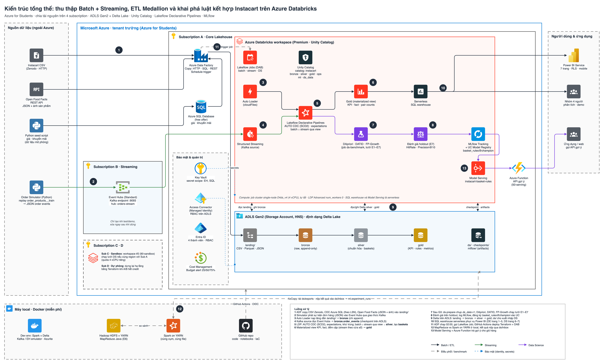
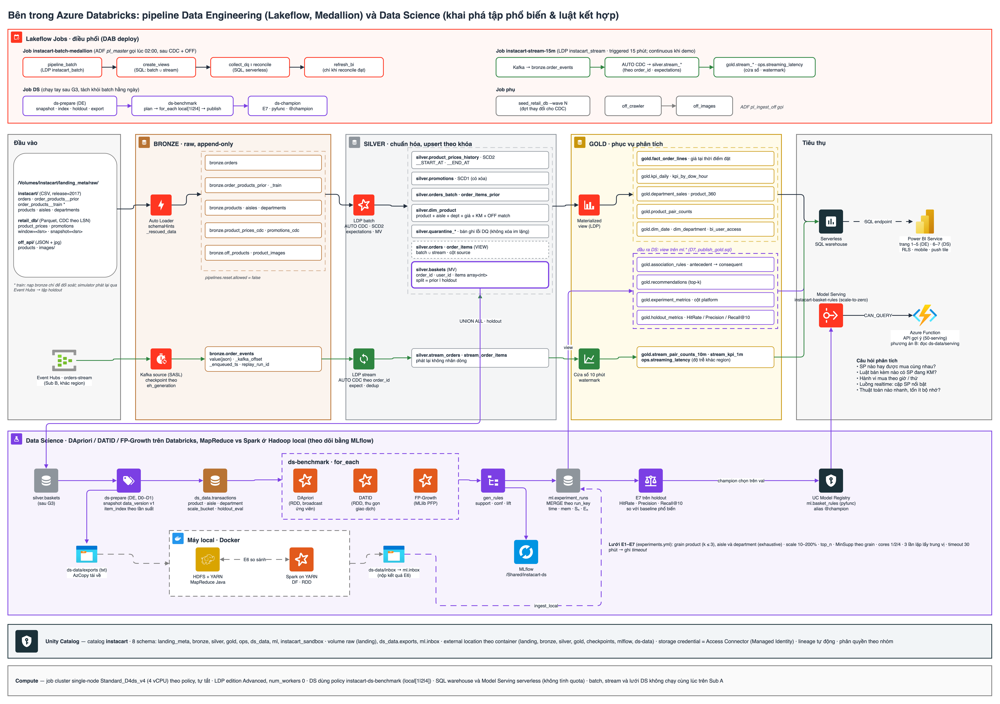

# 00 · Tổng quan dự án: ETL và khai phá luật kết hợp Instacart trên Azure Databricks

> File này là **điểm bắt đầu** cho người mới vào dự án. Nó trả lời: dự án làm gì, để làm gì, kiến trúc ra sao, và mỗi mảng (DevOps, DE, DS, BI) chạy theo quy trình nào.
> Chi tiết từng mảng nằm ở bộ tài liệu riêng. Mục 8 có bảng đọc tiếp.

---

## 1. Mục đích và ý nghĩa

### 1.1 Bài toán

Một chuỗi bán lẻ trực tuyến có lịch sử đơn hàng (giỏ hàng), danh mục sản phẩm, giá và khuyến mãi thay đổi theo thời gian, và đơn mới đổ về liên tục. Từ đó, nhóm cần trả lời được ba loại câu hỏi:

| Loại câu hỏi | Ví dụ | Ai dùng |
|---|---|---|
| **Vận hành / kinh doanh** | Doanh số theo ngày, giờ, ngành hàng; sản phẩm nào đang khuyến mãi; xu hướng theo thứ trong tuần | Quản lý ngành hàng, ban điều hành (Power BI) |
| **Gần thời gian thực** | Cặp sản phẩm nào đang được mua cùng nhau nhiều trong 10 phút gần nhất | Demo streaming |
| **Khai phá dữ liệu** | Sản phẩm nào hay được mua cùng nhau; luật bán kèm nào đủ mạnh để gợi ý; thuật toán phân tán nào nhanh hơn, tốn ít bộ nhớ hơn | DS, API gợi ý |

### 1.2 Đề tài

Đồ án môn học của nhóm 4 người, gồm hai nửa gắn với nhau:

1. **Xây dựng quy trình ETL trên Azure Databricks** (nửa Data Engineering):
   - Thu thập dữ liệu batch và streaming từ nhiều nguồn.
   - Xử lý qua các tầng medallion (bronze → silver → gold).
   - Phục vụ dashboard.
   - Phải tự động, chạy lại an toàn, và tiết kiệm chi phí.
2. **Khai phá tập mục phổ biến và luật kết hợp** (nửa Data Science), bám bài báo nền tảng ở mục 1.3:
   - Cài DApriori, DATID và FP-Growth.
   - So sánh hiệu năng theo quy mô dữ liệu, ngưỡng MinSupport, số item và số core.
   - So **Hadoop MapReduce với Spark** trên cùng một cụm.

### 1.3 Bài báo nền tảng của phần DS

**Trích dẫn:** C. Fernandez-Basso, M. D. Ruiz, M. J. Martin-Bautista, *New Spark solutions for distributed frequent itemset and association rule mining algorithms*, Cluster Computing 27, 1217–1234 (2024). DOI: [10.1007/s10586-023-04014-w](https://doi.org/10.1007/s10586-023-04014-w) (open access).

**Bài báo nói về gì:**
- Đề xuất ba thuật toán khai phá tập mục phổ biến **phân tán trên Spark RDD**, cả ba đều exhaustive (trả về mọi tập có support ≥ MinSupp):
  - **DApriori**: Apriori hai pha. Pha 1 đếm item. Pha 2 lặp theo k, sinh ứng viên bậc k+1 rồi broadcast dạng hash table.
  - **DATID**: như DApriori, nhưng sau pha 1 xóa item không phổ biến khỏi giao dịch để đếm trên dữ liệu thu gọn.
  - **DECLAT**: theo ECLAT (dữ liệu dọc).
- Sinh luật kết hợp phân tán (support, confidence).
- So sánh với YAFIM và PFP (FP-Growth của Spark MLlib) trên các bộ ít item (Poker, Susy, Higgs, Otto).
- Đo thời gian theo số giao dịch và số item, bộ nhớ, speedup Sₙ = T₁/Tₙ, efficiency Eₙ = Sₙ/n, số luật.
- Kết luận: PFP nhanh nhất; DATID tốn ít bộ nhớ nhất và là lựa chọn tốt khi cần đủ mọi luật; thời gian tăng theo hàm mũ khi số item tăng.

**Dự án bám bài báo thế nào:**

| Mức | Nội dung |
|---|---|
| Làm đúng như bài | DApriori và DATID viết bằng RDD, đúng cấu trúc hai pha và broadcast; FP-Growth MLlib làm mốc PFP; đo bằng đúng công thức Sₙ, Eₙ; thực nghiệm theo số giao dịch, số item, số core |
| Điều chỉnh cho Instacart | Instacart có 49.688 sản phẩm (bài chỉ tới 93 item), nên chạy exhaustive ở cấp aisle (134) và department (21), còn cấp product giới hạn k ≤ 3; phần cứng chỉ 4 vCPU nên đường speedup ngắn hơn |
| Bổ sung so với bài | Lift; kiểm chứng FP-Growth MLlib có exhaustive không; **đo thật MapReduce và Spark trên cùng cụm YARN** (bài chỉ lập luận); đánh giá luật trên holdout để gợi ý; MLflow và API |
| Không làm | DECLAT, YAFIM: chỉ ghi ở hướng mở rộng |

Bảng đối chiếu đầy đủ (đề tài gốc ↔ bài báo ↔ kế hoạch) là nguồn sự thật cho mọi việc DS, nằm ở [ds/00 §2](ds/00_tong_quan_ds.md). Khi viết code thuật toán hoặc thực nghiệm, đọc mục đó trước.

### 1.4 Ý nghĩa

- **Về kỹ thuật:** dự án đi trọn một vòng dữ liệu, gồm:
  - Ingest: CDC, API, sự kiện.
  - Lakehouse có quản trị (Unity Catalog).
  - Streaming khác region.
  - BI có phân quyền theo dòng (RLS).
  - Thực nghiệm thuật toán phân tán.
  - Đưa model thành API.
  - Toàn bộ hạ tầng viết bằng code (Terraform, Databricks Asset Bundles, GitHub Actions).
- **Về học thuật:** phần DS không chỉ chạy thư viện có sẵn:
  - Tái hiện các thuật toán của bài báo và kiểm tra đúng đắn chéo nhau.
  - Bổ sung phép đo MapReduce và Spark trên cùng cụm. Bài báo chỉ lập luận điểm này, không đo.
- **Về quản lý dự án:** làm trên Azure for Students (khoảng 4 vCPU và 100 USD mỗi subscription), nên mọi quyết định đều phải tính tới quota và chi phí. Đây cũng là bằng chứng cho rubric mục 5.4.

**Tiêu chí chấm điểm (rubric) nhóm nhắm tới:**
- Trọng tâm là **mục 4: phân tích và trực quan dữ liệu**.
- Có thêm bằng chứng cho **mục 3**: tốc độ đọc ghi, ETL tự động, độ trễ khi server ở region khác, tối ưu lưu trữ.
- Có thêm bằng chứng cho **mục 5.4**: làm việc nhóm, chi phí, quota.

## 2. Dữ liệu

| Nguồn | Nội dung | Quy mô | Cách vào hệ thống |
|---|---|---|---|
| **Instacart Market Basket** (Zenodo, CSV) | `orders`, `order_products__prior`, `order_products__train`, `products`, `aisles`, `departments` | 3.421.083 đơn của 206.209 khách; 32.434.489 dòng món hàng (prior); 49.688 sản phẩm | ADF copy một lần |
| **Azure SQL `retail_db`** (tự sinh bằng script) | `product_prices`, `promotions`: giá và khuyến mãi thay đổi theo đợt | Nhỏ, có insert/update/delete thật | ADF đọc **CDC theo LSN** |
| **Open Food Facts** (REST API) | Thông tin dinh dưỡng, nhãn hiệu, ảnh sản phẩm | Một phần danh mục (giới hạn tốc độ API) | Crawler Python theo lô |
| **Order simulator** (Python) | Phát lại `order_products__train` thành sự kiện JSON | 131.209 đơn, 1.384.617 món | Event Hubs (Kafka) |

Phần `train` được phát lại như đơn mới đến. Nó vừa là nguồn streaming, vừa là **tập holdout** để đánh giá luật kết hợp. Ý nghĩa từng bảng và cột ở [data_dictionary.md](data/data_dictionary.md).

## 3. Kiến trúc

### 3.1 Hình 1: kiến trúc tổng thể

File gốc: [architecture/instacart_azure_architecture.drawio](architecture/instacart_azure_architecture.drawio), trang 1.

Đọc hình theo số thứ tự trên các mũi tên:

| Số | Luồng | Mảng |
|---|---|---|
| 1 | ADF copy CSV Zenodo, CDC Azure SQL, Open Food Facts vào container `landing` | DE batch |
| 2 | Simulator phát sự kiện đơn hàng vào Event Hubs (Sub B, khác region) | DE stream |
| 3 | Auto Loader nạp tăng dần `landing` → bronze | DE batch |
| 4 | Kafka source đọc Event Hubs → `bronze.order_events` | DE stream |
| 5 | Lakeflow Declarative Pipelines: CDC → SCD2, kiểm chất lượng, gộp batch ∪ stream → silver, tạo `baskets` | DE |
| 6 | Materialized view KPI, fact, đếm cặp (stream theo cửa sổ) → gold | DE |
| 7–8 | DApriori, DATID, FP-Growth chạy lưới thực nghiệm; đánh giá trên holdout; MLflow + UC Model Registry | DS |
| 9 | Mọi bảng là Delta trên ADLS Gen2 | Nền tảng |
| 10 | Serverless SQL warehouse phục vụ Power BI | BI |
| 11 | ADF chạy theo lịch và gọi Lakeflow Job; GitHub Actions deploy hạ tầng và code | Điều phối, CI/CD |
| 12 | MapReduce và Spark on YARN chạy ở máy local, kết quả nộp lại lên Azure | DS |
| 13 | Model Serving + Azure Function trả món gợi ý cho một giỏ hàng | DS |

**Chia subscription:**

| Subscription | Vai trò | Nội dung chính |
|---|---|---|
| **A · Core** | Lakehouse chính | ADLS Gen2, Key Vault, Azure SQL, ADF, Databricks workspace, Model Serving, Azure Function |
| **B · Stream** | Streaming, **cố ý khác region** | Event Hubs. Chỉ tạo khi cần, tắt mỗi đêm |
| **C · Sandbox** | Thử nghiệm | Workspace #2 để chạy lưới DS (nếu cùng region với A) |
| **D · Dự phòng** | Dự phòng | Dựng lại hạ tầng bằng Terraform khi A hoặc B hết credit |

### 3.2 Hình 3: luồng tổng quan chỉ bằng icon

Hình 3 vẽ cùng luồng với hình 1 nhưng bỏ hết chữ, chỉ giữ tên nguồn dữ liệu và tên nhóm. Hình này hợp để chiếu lên slide hoặc giải thích nhanh bằng lời.

File gốc: [architecture/instacart_azure_architecture.drawio](architecture/instacart_azure_architecture.drawio), trang 3.

Màu mũi tên giống hình 1:
- Đen: batch / ETL.
- Xanh lá: streaming.
- Tím: Data Science.
- Xám nét đứt: điều phối, CI/CD, so sánh ở local.

### 3.3 Hình 2: bên trong Databricks

Hình 2 phóng to khối Databricks của hình 1. Nó cho biết:
- Từng bảng ở mỗi tầng.
- Các job điều phối.
- Đường đi chi tiết của phần DS, kể cả phần chạy ở máy local.

File gốc: [architecture/instacart_azure_architecture.drawio](architecture/instacart_azure_architecture.drawio), trang 2.

### 3.4 Thành phần theo lớp

| Lớp | Thành phần | Loại dịch vụ |
|---|---|---|
| Nguồn | Zenodo CSV, Open Food Facts API, Azure SQL, simulator | Ngoài Azure / PaaS |
| Thu thập | Azure Data Factory, Event Hubs (giao thức Kafka) | PaaS |
| Lưu trữ | ADLS Gen2 (HNS) + Delta Lake; container `landing`, `bronze`, `silver`, `gold`, `checkpoints`, `mlflow`, `ds-data` | PaaS |
| Xử lý | Azure Databricks: Lakeflow Declarative Pipelines (PySpark + Spark SQL), Lakeflow Jobs | PaaS (VM cluster tính là IaaS) |
| Quản trị | Unity Catalog (catalog `instacart`), Key Vault, Access Connector, Entra ID, Budget | PaaS / SaaS |
| Phục vụ | Serverless SQL warehouse, Model Serving, Azure Function | PaaS / FaaS |
| Tiêu thụ | Power BI Service (7 trang, RLS, mobile) | SaaS |
| Thực nghiệm local | Docker: Hadoop HDFS + YARN, MapReduce Java, Spark on YARN | Không thuộc cloud |
| Mã nguồn, CI/CD | GitHub, GitHub Actions (OIDC), Terraform, Databricks Asset Bundles | SaaS |

## 4. Quy trình tổng quan của từng mảng

### 4.1 DevOps: dựng nền trước, mở cổng cho người khác

**Tài liệu:** [devops/00](devops/00_tong_quan.md). **Người làm chính:** P1.

1. **Spike** (kiểm tra trước) trên Azure for Students: region được phép, quota, quyền, serverless, giấy phép Power BI.
2. **Bootstrap:**
   - Storage giữ Terraform state.
   - Danh tính `id-github-ci`, để GitHub Actions đăng nhập Azure bằng OIDC, không cần secret.
3. **Apply các stack Terraform theo thứ tự:**
   1. `10-core`: ADLS, Key Vault, Azure SQL, ADF, workspace, RBAC, budget.
   2. `30-databricks`: Unity Catalog, schema, quyền, policy, warehouse.
   3. `20-stream`: Event Hubs.
   4. Bundle deploy (job, pipeline, code).
   5. `40-orchestration`: pipeline ADF.
   6. `90-sandbox`.
   7. Tùy chọn `50-serving`: Azure Function.
4. **Phân chia việc:** Terraform lo "nền" (tài nguyên, quyền). DAB lo "việc" (job, pipeline, code). Code đổi hằng ngày không phải đi qua `terraform apply`.
5. **CI/CD:**
   - Mọi PR chạy kiểm tra, PR đụng `infra/` có plan.
   - Merge vào `main` thì apply và deploy, chờ duyệt ở environment `prod`.
   - Mỗi đêm tắt Event Hubs; mỗi tuần kiểm tra drift.

### 4.2 DE batch: từ nguồn tới gold

**Tài liệu:** [de/00](de/00_tong_quan_de.md) → 01, 02, 03, 05, 06. **Người làm chính:** P2.

1. **Ingest (02:00 hằng ngày, ADF `pl_master`):**
   - Copy CSV Zenodo, một lần.
   - Đọc CDC của Azure SQL theo LSN watermark.
   - Crawl Open Food Facts theo lô.
   - Kết quả ghi vào `landing`, tên thư mục tính từ nội dung (`release=`, `window=<lsn>`).
2. **Gọi job `instacart-batch-medallion`:**
   1. `pipeline_batch` chạy pipeline LDP `instacart_batch`:
      - Auto Loader → bronze.
      - `AUTO CDC` (SCD2 cho giá, SCD1 cho khuyến mãi) và expectations → silver; bản ghi lỗi vào `quarantine_*`.
      - Materialized view → gold.
   2. `create_views`: gộp batch ∪ stream ở silver bằng view.
   3. `collect_dq` và `reconcile`: ghi `ops.dq_results`, `ops.reconciliation`.
   4. `refresh_bi`: chỉ chạy khi đối soát đạt.
3. **Chạy lại an toàn theo tầng:**

   | Tầng | Quy tắc |
   |---|---|
   | Landing | Bất biến |
   | Bronze | Chỉ append, không cho full refresh |
   | Silver | Upsert theo khóa |
   | Gold | Tính lại được |

   Lỗi ở đâu thì chạy lại đúng chỗ đó, không mất và không trùng dữ liệu ([de/06](de/06_van_hanh_chay_lai.md)).

### 4.3 DE streaming: đơn hàng gần thời gian thực

**Tài liệu:** [de/04](de/04_streaming.md). **Người làm chính:** P3.

1. Simulator (ở máy local) phát sự kiện JSON vào Event Hubs ở Sub B, key là `order_id`.
2. Pipeline LDP `instacart_stream` xử lý:
   - Kafka → `bronze.order_events`.
   - `AUTO CDC` theo `order_id` → `silver.stream_orders`, `stream_order_items`. Phát lại không nhân dòng.
   - Cửa sổ 10 phút có watermark → `gold.stream_pair_counts_10m`, `stream_kpi_1m`.
3. **Cách chạy:**
   - Mặc định triggered mỗi 15 phút (job `instacart-stream-15m`).
   - Lúc demo chạy continuous.
   - Không chạy cùng lúc với batch, vì chung 4 vCPU.
4. **Đo độ trễ khác region:** `ops.streaming_latency` ghi từng chặng `event_ts → enqueued_ts → bronze_ts → silver_ts`.

### 4.4 Data Science: khai phá luật kết hợp và so sánh nền tảng

**Tài liệu:** [ds/00](ds/00_tong_quan_ds.md) → 01–05; dữ liệu do DE chuẩn bị ở [de/08](de/08_du_lieu_cho_ds.md). **Người làm chính:** P4, có P2 hỗ trợ dữ liệu.

1. **D0–D1 (DE, job `ds-prepare`, sau G3):**
   - Chụp `silver.baskets` thành bản cố định `ds_data` (`data_version = v1`).
   - Đánh số item theo tần suất.
   - Dựng giao dịch ở 3 cấp: product, aisle, department.
   - Tách tập holdout.
   - Xuất file txt ra container `ds-data` cho Hadoop.
2. **D2:** khám phá dữ liệu, chọn lưới MinSupport cho từng cấp.
3. **D3–D4 (job `ds-benchmark`):**
   - Chạy DApriori, DATID (RDD, đúng cấu trúc bài báo) và FP-Growth (MLlib), rồi sinh luật.
   - Lưới thực nghiệm E1–E5: đúng đắn, MinSupport, quy mô, số item, speedup.
   - Kết quả ghi `ml.experiment_runs` (khóa `run_key`, chạy lại không trùng) và MLflow.
4. **D5 (máy local):**
   - Cụm Docker Hadoop HDFS + YARN.
   - MapReduce Java so với Spark on YARN trên cùng file (E6).
   - Kết quả nộp qua `ds-data/inbox`.
5. **D6 (job `ds-champion`):**
   - Đánh giá trên holdout (E7: HitRate, Precision, Recall@10, so với baseline phổ biến).
   - Chọn champion.
   - Đóng gói luật thành model `pyfunc` `basket_rules@champion`.
   - Phục vụ qua Model Serving và Azure Function. Phương án B: Function tự đọc luật từ `ds-data/serving`.
6. **D7:** view `gold.association_rules`, `recommendations`, `experiment_metrics`, `holdout_metrics` cho Power BI.

### 4.5 BI: dashboard đạt rubric mục 4

**Tài liệu:** [de/07](de/07_power_bi.md), [devops/06 §5](devops/06_de_den_dashboard.md). **Người làm chính:** P3; trang 6–7 do P4.

- Power BI Service đọc gold qua serverless SQL warehouse.
- Star schema: fact `fact_order_lines`, các dim ngày, sản phẩm, ngành hàng.
- Các trang báo cáo:
  - Trang 1–4: tổng quan, chi tiết sản phẩm, thời gian mua, danh mục.
  - Trang 5: vận hành và real-time (streaming, độ trễ, chất lượng dữ liệu).
  - Trang 6–7: luật kết hợp, kết quả thực nghiệm.
- RLS theo `bi_user_access`, bố cục mobile.
- Tile real-time qua push semantic model.
- Refresh chỉ sau khi đối soát batch đạt.

## 5. Nguyên tắc xuyên suốt

| Nguyên tắc | Cụ thể |
|---|---|
| Hạ tầng là code | Không tạo tay trên Portal; apply chỉ qua PR → workflow |
| Chạy lại an toàn | Landing bất biến, bronze append, silver upsert theo khóa, gold tính lại; DS ghi theo `run_key` |
| Một nguồn sự thật | Batch và stream gặp nhau ở silver; DS và Hadoop đọc cùng bản `ds_data` v1 |
| Tiết kiệm là yêu cầu | Cluster single-node tự tắt; warehouse và Model Serving serverless; Event Hubs tắt mỗi đêm; budget alert 25/50/75% |
| Không lộ bí mật | Secret ở Key Vault; CI dùng OIDC; không commit ID, email, connection string |
| Tài liệu đi trước code | Đọc tài liệu tương ứng trước khi viết code; sơ đồ bằng draw.io |

## 6. Cổng và lộ trình

| Cổng | Điều kiện | Mở khóa cho |
|---|---|---|
| **G0** | Spike xong: chốt region, cách đăng nhập, phương án serving | DE viết code local; DS đọc bài báo, viết thuật toán trên dữ liệu đồ chơi |
| **G1** | Có ADLS, external location, catalog | DE bắt đầu trên cloud: landing → bronze |
| **G2** | Event Hubs, simulator, bronze stream | Streaming sẵn sàng |
| **G3** | Silver đạt đối soát | `ds-prepare` chạy → **DS bắt đầu trên cloud**; BI nối thử gold |
| **G4** | Gold + Power BI đạt rubric | Demo phần trực quan |
| **G5** | Đủ E1–E7, champion, API, trang 6–7 | Báo cáo DS |

Lộ trình theo tuần và checklist từng cổng ở [devops/00 §3, §6](devops/00_tong_quan.md) và [devops/06 §6–7](devops/06_de_den_dashboard.md).

## 7. Phân vai

| Vai | Phụ trách |
|---|---|
| **P1 · Platform / DevOps** | Sub A (từ 27/11 vận hành trên Sub D), Terraform, CI/CD, Unity Catalog, chi phí; hạ tầng DS (serving, Function) |
| **P2 · DE batch** | Chủ Sub D (subscription chính từ 27/11); ADF, Auto Loader, bronze → silver → gold, chất lượng dữ liệu, `ds-prepare` |
| **P3 · DE streaming + BI** | Sub B, simulator, pipeline stream, đo độ trễ; Power BI (semantic model, 5 trang, RLS, mobile, real-time) |
| **P4 · DS** | Sub C (không dùng được; DS chạy trên Sub D, #31); DApriori / DATID / FP-Growth, Hadoop / MapReduce local, thực nghiệm, MLflow, API, Power BI trang 6–7 |

Mỗi PR cần ít nhất một người khác duyệt; quy ước commit và PR ở [CONTRIBUTING.md](../CONTRIBUTING.md).

## 8. Đọc tiếp

| Muốn biết | Đọc |
|---|---|
| Dựng hạ tầng, CI/CD, quyền, cổng | [devops/00_tong_quan.md](devops/00_tong_quan.md) → 01–06 |
| Pipeline dữ liệu, CDC, streaming, chạy lại, Power BI | [de/00_tong_quan_de.md](de/00_tong_quan_de.md) → 01–08 |
| Thuật toán, thực nghiệm, Hadoop local, MLflow, API | [ds/00_tong_quan_ds.md](ds/00_tong_quan_ds.md) → 01–05 |
| Ý nghĩa bảng, cột, số dòng đối soát | [data/data_dictionary.md](data/data_dictionary.md) |
| Quy tắc cho coding agent | [AGENTS.md](../AGENTS.md) |
