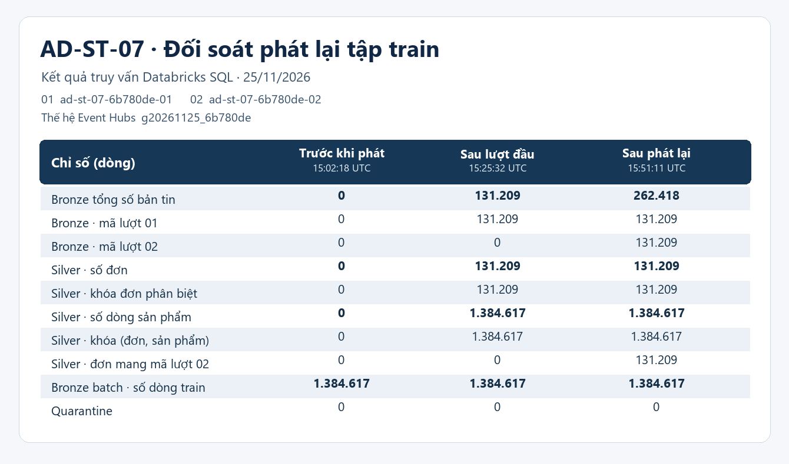

# Nghiệm thu phát lại tập train (AD-ST-07)

Nghiệm thu ngày 25/11/2026 trên pipeline Databricks dev riêng với code ở `d126a5b` và `eh_generation=g20261125_6b780de`. Ba update dùng chung checkpoint. Mỗi update chỉ refresh bốn bảng Bronze và Silver phục vụ đối soát. [Issue #70](https://github.com/Vinh5905/ETL_Azure_Databricks/issues/70) · [Lượt bật Event Hubs](https://github.com/Vinh5905/ETL_Azure_Databricks/actions/runs/45638211092)

## Lượt phát và update

| Mốc | `replay_run_id` | Giờ gửi (UTC) | Broker xác nhận | Xác nhận update hoàn tất (UTC) | Giờ đối soát (UTC) |
| --- | --- | --- | ---: | --- | --- |
| Trước khi phát | — | — | — | 15:02:03 | 15:02:18 |
| Phát đủ tập train | `ad-st-07-6b780de-01` | 15:02:20–15:14:49 | 131.209 | 15:25:20 | 15:25:32 |
| Phát lại đủ tập train | `ad-st-07-6b780de-02` | 15:25:35–15:38:12 | 131.209 | 15:50:59 | 15:51:11 |

## Kết quả đối soát

Ảnh được dựng từ ba kết quả của [truy vấn đối soát](../../stream_replay_reconciliation.sql) chạy trên `wh-instacart-bi`.

- Bảng batch `instacart.bronze.order_products_train` có 131.209 đơn, 1.384.617 dòng sản phẩm và 1.384.617 khóa `(order_id, product_id)` phân biệt. Hai số đếm của Silver stream khớp bảng batch sau cả hai lượt.
- Sau phát lại, Bronze có 262.418 dòng với hai nhóm `replay_run_id`. Mỗi nhóm có 131.209 dòng và 131.209 `event_id` phân biệt.
- Silver giữ 131.209 khóa đơn và 1.384.617 khóa dòng sản phẩm. Toàn bộ 131.209 đơn Silver mang `replay_run_id` mới. Quarantine ghi 0 dòng ở cả ba mốc.

Lệnh demo 95/5 và cách khôi phục khi namespace hoặc checkpoint bị mất nằm trong [runbook](../../06_van_hanh_chay_lai.md#61-phát-lại-toàn-bộ-tập-train-ad-st-07).
