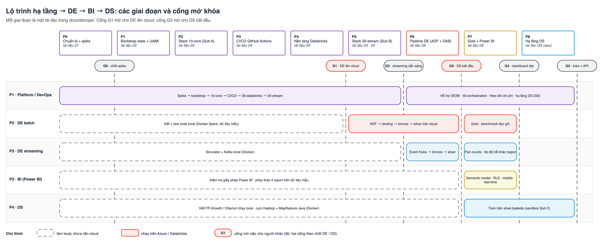

# 00 · Kế hoạch DevOps tổng quan

> Bộ tài liệu `docs/devops/` mô tả cách dựng toàn bộ hạ tầng bằng **Terraform** và đưa code lên **tự động bằng GitHub Actions**. Bộ tài liệu cũng chỉ rõ **mốc nào DE được bắt đầu trên cloud** và **mốc nào DS được bắt đầu**.
> Kiến trúc đích nằm ở [docs/architecture](../architecture/). Dữ liệu được mô tả trong [data_dictionary.md](../data/data_dictionary.md).

| Thứ tự đọc | File | Trả lời câu hỏi |
|---|---|---|
| 0 | `00_tong_quan.md` (file này) | Làm gì, theo thứ tự nào, ai làm, khi nào xong |
| 1 | [01_chuan_bi_va_spike.md](01_chuan_bi_va_spike.md) | Cài gì; kiểm tra gì trên Azure for Students trước khi viết Terraform |
| 2 | [02_bootstrap_tfstate.md](02_bootstrap_tfstate.md) | Terraform state để ở đâu; CI đăng nhập Azure bằng gì |
| 3 | [03_terraform_azure.md](03_terraform_azure.md) | Dựng từng tài nguyên Azure theo thứ tự nào, vì sao cần, code gì |
| 4 | [04_github_actions_cicd.md](04_github_actions_cicd.md) | PR, plan, apply, deploy tự động diễn ra thế nào |
| 5 | [05_databricks_platform.md](05_databricks_platform.md) | Unity Catalog, phân quyền, cluster, warehouse bên trong Databricks |
| 6 | [06_de_den_dashboard.md](06_de_den_dashboard.md) | Đưa pipeline DE và Power BI lên cloud, nghiệm thu từng cổng |

---

## 1. Mục tiêu: hạ tầng phục vụ tiêu chí chấm điểm nào

Nhóm tập trung vào **mục 4 (phân tích dữ liệu + trực quan dữ liệu)**. Hạ tầng phải sẵn sàng cho mục 4, đồng thời tạo bằng chứng cho mục 3 và mục 5.

| Tiêu chí (rubric) | Hạ tầng / DevOps phải cung cấp | Ở tài liệu |
|---|---|---|
| 1.4 Thành phần cloud thuộc IaaS/PaaS/FaaS/SaaS | Bảng phân loại ở mục 5 bên dưới | 00 |
| 3.1 Tốc độ đọc ghi | Cluster cố định theo policy để kết quả benchmark lặp lại được; bảng `ops.benchmark_results` (CSV, Parquet, Delta, Delta có OPTIMIZE) | 05, 06 |
| 3.2 Luồng ETL tự động | ADF schedule trigger → Databricks Job; Auto Loader; streaming job chạy liên tục | 03, 06 |
| 3.3 Độ trễ khi server ở region khác | **Event Hubs đặt ở Sub B, cố ý chọn region khác Sub A.** Đo `enqueuedTime` → `_ingest_ts` → thời điểm có trong silver/gold | 03, 06 |
| 3.4 Tối ưu lưu trữ, tăng tốc đọc ghi | Lifecycle (landing chuyển sang cool), partition, OPTIMIZE, liquid clustering, VACUUM; định dạng Delta | 03, 05 |
| 4 · Trực quan: dashboard trên SaaS, 4 report và điều hướng | Power BI Service + SQL warehouse (hoặc lớp serving dự phòng) | 06 |
| 4 · Trực quan: cập nhật tức thời | Streaming job → gold; Power BI DirectQuery + push semantic model cho tile real-time | 06 |
| 4 · Trực quan: bảo mật, chia sẻ, RLS | Vai trò RLS trong semantic model; nhóm Entra ID; quyền đọc gold trong Unity Catalog | 05, 06 |
| 4 · Trực quan: responsive mobile | Bố cục mobile cho từng trang báo cáo Power BI | 06 |
| 4 · Phân tích: train, API model, trực quan tham số | Schema `ds_data`/`ml`, policy cho chọn số core, MLflow, UC model registry, model serving, Azure Function (cổng G5) | 03, 05, [ds/](../ds/00_tong_quan_ds.md) |
| 5.4 Quản lý dự án trên cloud: nhiều người cùng làm trên một resource, GitHub, chi phí và quota | RBAC cho 4 người, tag `owner`, budget alert, Infracost trên PR, GitHub Projects/PR review, bảng quota | 02, 03, 04 |

## 2. Nguyên tắc thiết kế

1. **Mọi tài nguyên Azure và Databricks đều là code.** Không tạo tay trên Portal. Trường hợp buộc phải làm tay (giấy phép Power BI, bật trial…) thì ghi vào checklist.
2. **State tập trung, khóa được.** State nằm ở một Storage Account trong Sub A. Blob lease đảm bảo 4 người không `apply` chồng lên nhau.
3. **CI không giữ secret dài hạn.** GitHub Actions đăng nhập Azure bằng OIDC qua *user-assigned managed identity*. Cách này không cần App Registration, phòng trường hợp tenant của trường chặn tạo App Registration.
4. **Tách stack theo vòng đời.**
   - Phần lõi (Sub A) gần như cố định.
   - Phần streaming (Sub B) được bật và tắt theo buổi để tiết kiệm.
   - Nền tảng Databricks cần workspace đã tồn tại.
   - Pipeline ADF thay đổi thường xuyên.
5. **Terraform lo "nền", Databricks Asset Bundles (DAB) lo "việc".** Terraform tạo workspace, catalog, quyền, warehouse. DAB deploy job, notebook, pipeline. Code DE thay đổi hằng ngày không phải đi qua `terraform apply`.
6. **Tiết kiệm là yêu cầu chức năng.**
   - Cluster single-node, tự tắt.
   - Event Hubs chỉ tồn tại lúc cần.
   - Budget alert ở 25/50/75%.
   - Lịch tự động hủy tài nguyên streaming mỗi đêm.

## 3. Các giai đoạn và cổng mở khóa

File gốc: [diagrams/devops_diagrams.drawio](diagrams/devops_diagrams.drawio), trang 1.

| Giai đoạn | Việc chính | Tài liệu | Cổng khi xong | Mở khóa cho |
|---|---|---|---|---|
| P0 · Chuẩn bị + spike | Cài công cụ; kiểm tra region được phép, quota, quyền, serverless, giấy phép Power BI | 01 | **G0**: đã chốt region, cách auth, phương án serving | DE viết code **local** (Docker + Spark, dữ liệu mẫu); DS đọc tài liệu thuật toán |
| P1 · Bootstrap | Storage lưu state, UAMI cho CI, federated credential, quyền vào state | 02 | (nội bộ) | Mọi stack sau |
| P2 · Stack core (Sub A) | RG, ADLS, Key Vault, Access Connector, Databricks workspace, Azure SQL, ADF, RBAC, Budget | 03 | — | P3, P4 |
| P3 · CI/CD | Workflow PR check / plan / apply; branch protection; environment `prod` | 04 | — | Mọi thay đổi sau đi qua PR |
| P4 · Nền tảng Databricks | UC: storage credential, external location, catalog/schema, nhóm, quyền, policy, secret scope, warehouse | 05 | **G1: DE bắt đầu trên cloud** | ADF và Auto Loader nạp landing → bronze |
| P5 · Stack stream (Sub B) | Event Hubs, SAS vào Key Vault, workflow bật/tắt | 03, 04 | **G2: streaming sẵn sàng** | Simulator → Event Hubs → `bronze.order_events` |
| P6 · Pipeline DE | ADF pipeline (stack orchestration), DAB jobs batch + streaming, kiểm tra DQ | 06 | **G3: silver đạt đối soát** | **DS bắt đầu** trên `silver.baskets`; BI nối thử gold dev |
| P7 · Gold + Power BI | Gold, lớp serving, semantic model, 4 report, RLS, mobile, cập nhật real-time | 06 | **G4: dashboard đạt rubric** | Demo phần trực quan |
| P8 · Hạ tầng DS | Container `ds-data`, schema `ds_data`, policy `instacart-ds-benchmark`, MLflow, serving endpoint, stack `50-serving` (Function), cụm Hadoop Docker ở máy local | 03, 05, [ds/](../ds/00_tong_quan_ds.md) | **G5** | Thực nghiệm DApriori / DATID / FP-Growth, MapReduce và Spark, API model, trang 6–7 |

**Hai điểm then chốt người dùng hỏi:**
- **DE bắt đầu trên cloud ở G1.** Lúc này đã có ADLS, External Location và catalog `instacart`. Trước G1, DE vẫn viết và test code bằng PySpark local, vì code chạy được trên cả hai môi trường.
- **DS bắt đầu ở G3.** Lúc này `silver.baskets` (prior | holdout) đã qua đối soát số dòng, và DE chạy job `ds-prepare` để chụp thành bản cố định `ds_data.*` ([de/08](../de/08_du_lieu_cho_ds.md)). DS chạy thực nghiệm trên workspace #2 (Sub C) nếu cùng region với Sub A, nếu không thì trên Sub A ngoài giờ batch. Phần Hadoop MapReduce chạy ở máy local bằng Docker ([ds/03](../ds/03_hadoop_mapreduce_local.md)).

## 4. Phân vai 4 người

| Vai | Giữ subscription | Phụ trách chính | Code owner |
|---|---|---|---|
| **P1 · Platform / DevOps** | Sub A (core) | Tài liệu 01–05, stack `bootstrap`, `10-core`, `30-databricks`, workflow CI/CD, chi phí | `infra/**`, `.github/**` |
| **P2 · DE batch** | — (dùng Sub A) | ADF pipeline, Auto Loader, bronze → silver → gold batch, DQ | `adf/**`, `src/ingest/**`, `src/pipelines/batch/**`, `src/tasks/**` |
| **P3 · DE streaming + BI** | Sub B (stream) | Stack `20-stream`, simulator, streaming jobs, đo độ trễ khác region; Power BI (semantic model, 5 trang, RLS, mobile, real-time) | `src/streaming/**`, `src/pipelines/stream/**`, `infra/stacks/20-stream/**`, `powerbi/**` |
| **P4 · DS** | Sub C (sandbox), Sub D dự phòng | DApriori / DATID / FP-Growth, cụm Hadoop + MapReduce local, thực nghiệm, MLflow, API, Power BI trang 6–7 | `src/ml/**`, `src/mapreduce/**`, `local/hadoop/**`, `src/serving_func/**` |

Mỗi PR cần ít nhất 1 người khác duyệt. PR đụng `infra/**` bắt buộc có P1 duyệt (CODEOWNERS). Lịch sử PR, review, issue và board trên GitHub Projects là bằng chứng cho rubric 5.4.

## 5. Phân loại dịch vụ cloud (rubric 1.4)

| Thành phần | Dùng để | Nhóm |
|---|---|---|
| VM của cluster Databricks (classic compute) | Chạy Spark | **IaaS** (VM nằm trong subscription của mình, tính vào quota vCPU) |
| Azure Databricks workspace, Lakeflow Jobs | Notebook, job, Unity Catalog | **PaaS** |
| Databricks serverless SQL warehouse / model serving | Phục vụ truy vấn BI, API model | **PaaS** (serverless, không tính quota) |
| ADLS Gen2, Azure SQL Database, Event Hubs, Data Factory, Key Vault | Lưu trữ, nguồn SQL, hàng đợi sự kiện, điều phối, bí mật | **PaaS** |
| Azure Functions (tùy chọn ở G5) | Proxy HTTP gọi model serving cho web | **FaaS** |
| Cụm Hadoop HDFS + YARN, Spark on YARN (Docker trên máy thành viên) | So sánh MapReduce và Spark | **Không thuộc cloud.** Ghi rõ trong báo cáo là môi trường thực nghiệm local |
| Power BI Service, GitHub, Entra ID | Dashboard, mã nguồn và CI, danh tính | **SaaS** |

## 6. Timeline (tuần tương đối, căn theo hạn nộp thật)

| Tuần | P1 Platform | P2 DE batch | P3 DE stream + BI | P4 DS | Cổng |
|---|---|---|---|---|---|
| 1 | Spike, bootstrap, stack core | Code ingest + silver local | Simulator local (Kafka trong Docker); kiểm tra giấy phép Power BI, phác thảo 4 report | Cài DApriori / DATID / FP-Growth và test local; dựng cụm Hadoop Docker | G0 |
| 2 | CI/CD, stack Databricks | ADF Zenodo + SQL → landing → bronze | Stack stream, Kafka → bronze; mockup report trên dữ liệu mẫu | MapReduce Java ItemCount / PairCount, đếm cặp Spark on YARN | G1, G2 |
| 3 | Stack orchestration, Infracost | Silver + DQ + đối soát | stream → silver, MERGE; semantic model dev | Lưới thực nghiệm, `run_experiment`, holdout | G3 |
| 4 | Hỗ trợ, tối ưu chi phí | Gold batch, benchmark đọc ghi; `ds-prepare` ngay sau G3 | Đo độ trễ; publish Power BI, RLS, mobile, real-time | EDA + spike hiệu năng DS (DS-1) | G4 |
| 5–6 | Hạ tầng DS (G5): serving, `50-serving` | Tối ưu (OPTIMIZE, clustering) | Mở rộng semantic model cho view DS, hỗ trợ trang 6–7 | Lưới E1–E7 (gồm E6 MapReduce local), champion, trang 6–7 | G5 |
| 7 | Báo cáo chi phí, quota | Báo cáo | Báo cáo + demo dashboard | Báo cáo phần DS | — |

## 7. Rủi ro lớn nhất (chi tiết ở tài liệu 01)

| Rủi ro | Ảnh hưởng | Phương án |
|---|---|---|
| Quota vCPU của Students rất thấp, không xin tăng được | Cluster batch, streaming và SQL warehouse classic không chạy song song được | Single-node `Standard_D4ds_v4` (4 vCPU, chốt ở G0 vì Sub A không mua được DS3_v2); streaming chạy kiểu `availableNow` theo lô; dùng warehouse **serverless**; thí nghiệm DS chạy ở Sub C |
| Policy chỉ cho phép một số region | Databricks / Event Hubs / SQL free offer không có ở region được phép | Spike chọn region giao nhau; Sub B có thể đặt ở region khác (đây cũng là thí nghiệm 3.3) |
| Không có quyền admin Unity Catalog (metastore) | Không tạo được storage credential / external location | Dùng managed storage của catalog mặc định |
| Power BI Pro: auto page refresh tối thiểu 30 phút | "Real-time" không đạt nếu chỉ dựa vào DirectQuery | Thêm **push semantic model** (tile cập nhật trong vài giây) cho KPI streaming |
| Hết credit $100 | Mất tài nguyên giữa chừng | Budget alert, hủy stream mỗi đêm; hạ tầng dựng lại được bằng code ở Sub C/D. Workspace SKU `premium` không có trial nên DBU tính từ ngày đầu (spike 3.4): ưu tiên serverless ngắn hạn, cluster tự tắt, pipeline dev đặt `pipelines.clusterShutdown.delay` ngắn |
| Lưới thực nghiệm DS chạy quá lâu trên 4 vCPU (PySpark RDD chậm) | Không kịp đủ số liệu cho báo cáo | Spike DS-1 đo trước rồi mới chốt lưới; timeout 30 phút / lần chạy, ghi `timeout` thay vì bỏ ([ds/04 §2](../ds/04_thuc_nghiem_danh_gia.md)) |
| Model Serving / Function không tạo được trên Students | Thiếu "API model" | Phương án B: Function tự tra luật từ file Parquet của champion ([ds/05 §3.3](../ds/05_mlflow_serving_bao_cao.md)) |
