# Theo dõi chi phí và quota vCPU (AD-OPS-28)

Bằng chứng cho rubric 5.4 (chi phí, quota) và checklist G4 (`docs/devops/06` §6.4). Credit Azure for Students là 100 USD cho cả năm. Budget `budget-sub-a` (stack `10-core`, bước 3.9) gửi email ở các mốc 25/50/75/90 USD.

## 1. Cách ghi số mỗi tuần

P1 ghi số vào **thứ Năm** hằng tuần.

1. Chạy script. Nó chỉ đọc dữ liệu, không in subscription ID hay email, nên dán thẳng kết quả vào file này được:
   ```bash
   az account set --subscription "Azure for Students"
   uv run python scripts/cost_report.py --to <ngày ghi> --dbx-profile instacart
   ```
   Phần Databricks là **ước tính** (§3, mục "DBU theo warehouse, job, pipeline"). P1 không có quyền đọc `system.billing`: metastore do hệ thống tạo, chỉ account admin mới gán được metastore admin, mà P1 không phải account admin.
2. Thêm một dòng vào bảng §2. Dán các bảng chi tiết vào §3 dưới tiêu đề của tuần đó.
3. Ghi lại email cảnh báo budget đã nhận trong tuần, nếu có.
4. Lưu ảnh chụp vào `docs/devops/evidence/` theo tên `<ngày>_<nội dung>.png`. Trước khi lưu, che subscription ID và email (repo public).
   - Cost analysis: https://portal.azure.com/#view/Microsoft_Azure_CostManagement/Menu/~/costanalysis (mở view ở bảng dưới, hoặc tự chọn **Group by → Tag**). Chỉ chụp vùng biểu đồ và bảng số.
   - Quota: https://portal.azure.com/#view/Microsoft_Azure_Capacity/QuotaMenuBlade/~/myQuotas → **Compute**, lọc **East Asia**, tìm `vCPUs`.

**View lưu sẵn trong Cost Management:** vào Portal → *Cost Management* → *Cost analysis* → *Views*. Stack `10-core`, bước 3.11, tạo 3 view:

| View | Nhóm theo | Dùng để |
|---|---|---|
| `Instacart: chi phí theo tag owner` | Tag `owner` (`p1`…`p4`) | Ảnh chi phí theo người |
| `Instacart: chi phí theo tag stack` | Tag `stack` | Ảnh chi phí theo stack Terraform |
| `Instacart: chi phí theo tag cost_owner` | Tag `cost_owner` của cluster và warehouse Databricks | Ảnh DBU theo người dùng compute |

Cả ba view đều hiển thị tháng hiện tại, chia theo ngày, kèm KPI dự báo. Có thể đổi trục xem sang resource group hoặc service.

**Sub B (P3):** stack `20-stream` bị destroy mỗi đêm, nên view không đặt trong Terraform. P3 tự tạo view trên portal, nhóm theo tag `owner`/`stack`, và gửi P1 số lũy kế mỗi tuần.

## 2. Bảng theo tuần

Đơn vị: USD. Lũy kế tính từ 2026-11-01, là ngày bắt đầu budget.

| Ngày ghi | Lũy kế Sub A (Cost analysis) | Budget báo đã tiêu | Dự báo | Chi phí ngày gần nhất | Sub B | Cảnh báo budget đã nhận | vCPU đang dùng / giới hạn (eastasia) |
|---|---:|---:|---|---:|---|---|---|
| 2026-11-19 | 22,47 | 12,06 | Chưa có (budget mới tạo) | 12,80 (18/11) | Chưa có số | Chưa nhận | Tổng 4/6, DDSv4 4/4 |
| 2026-11-26 | 96,66 | 95,87 (96%) | 142,47 tới 30/11 (Cost analysis) | 8,15 (26/11) | 0,19 lũy kế tới 25/11, chỉ có Event Hubs; 0,04 ngày 25/11; Sub B không có budget | Chưa nhận email nào, dù đã qua mốc 90% (§3, tuần 2) | Tổng 0/6, DDSv4 0/4 (đo 27/11) |

Số tuần 1 ghi lúc Cost Management mới có một phần dữ liệu. Azure đã cập nhật lại: lũy kế tới 19/11 thực ra là **74,38 USD**, không phải 22,47. Bảng giữ nguyên số đã ghi để thấy độ trễ dữ liệu; chi tiết ở §3, tuần 2.

## 3. Chi tiết từng tuần

### 2026-11-19 (tuần 1)

Cost Management mới có dữ liệu ngày 17/11 và 18/11. Chi phí các ngày trước đó chưa được ghi.

| Tag `owner` | USD |
|---|---:|
| p1 | 12,80 |
| (không có tag) | 9,67 |

| Tag `stack` | USD |
|---|---:|
| 10-core | 12,80 |
| (không có tag) | 9,67 |

| Tag `cost_owner` | USD |
|---|---:|
| (không có tag) | 15,77 |
| p3 | 5,06 |
| p2 | 1,43 |
| p1 | 0,21 |

| Resource group | USD |
|---|---:|
| rg-instacart-core | 11,65 |
| rg-spike | 8,10 |
| rg-spike-dbw-managed | 1,57 |
| rg-instacart-dbw-managed | 1,15 |

| Meter | USD |
|---|---:|
| Premium Serverless SQL DBU | 15,02 |
| Premium Automated Serverless Compute DBU | 2,09 |
| D4ds v4 (máy của job/pipeline cluster) | 1,14 |
| Standard Gateway (NAT của workspace spike) | 1,08 |
| Premium Interactive Serverless Compute DBU | 0,79 |
| Premium Advanced Compute Delta Live Tables DBU | 0,62 |
| Cloud Data Movement (ADF) | 0,53 |
| P15 LRS Disk | 0,26 |
| Premium Serverless Realtime Inferencing DBU | 0,25 |
| Cloud Orchestration Activity Run (ADF) | 0,23 |
| Standard IPv4 Static Public IP | 0,17 |
| Premium Jobs Compute DBU | 0,13 |

**DBU theo warehouse, job, pipeline (ước tính).** Đơn giá thật lấy từ Azure (USD chia số lượng): serverless SQL 0,95 USD/DBU, serverless job 0,52 USD/DBU, DLT Advanced 0,54 USD/DBU.

Giờ chạy warehouse ước tính từ lịch sử truy vấn: các truy vấn cách nhau dưới 10 phút gộp thành một phiên, mỗi phiên cộng thêm 10 phút rảnh ở cuối.
- Ngày 18/11, cách này ra 14,6 DBU, trong khi Azure tính 9,42 DBU. Vậy cách ước tính cho số **cao hơn thật**.
- Vì vậy chỉ dùng tỷ lệ thời gian truy vấn để chia chi phí thật cho từng người.

| Ngày | Số truy vấn | Số phiên | Giờ chạy ước tính | DBU ước tính | USD thật (Azure) | Chia theo thời gian truy vấn |
|---|---:|---:|---:|---:|---:|---|
| 2026-11-18 | 193 | 14 | 3,6 | 14,6 | 8,95 | người dùng khác 1: 44% ≈ 3,93 USD; P1 (người chạy script): 34% ≈ 3,06 USD; service principal: 22% ≈ 1,97 USD |
| 2026-11-19 | 82 | 3 | 1,1 | 4,2 | chưa có | P1 38%, người dùng khác 1 32%, service principal 30% |

| Job / pipeline (13–19/11) | Số lần chạy | Tổng phút |
|---|---:|---:|
| job `seed-retail-db` | 6 | 34 |
| pipeline `[dev người 2] instacart-batch` | 3 | 32 |
| pipeline `instacart-batch` (prod) | 2 | 31 |
| job `[dev người 1] instacart-off-crawler` | 2 | 13 |
| pipeline `[dev người 1] instacart-batch-off-review` | 1 | 11 |
| pipeline `[dev người 1] instacart-batch` | 2 | 3 |
| job `tmp-ad-ops-21b-job-probe` | 1 | 3 |
| job `ad-ops-23-kv-check` | 1 | 0 |

Job và pipeline chỉ chạy khoảng 2 giờ, tốn chưa tới 3 USD. Phần lớn chi phí Databricks nằm ở warehouse.

Ảnh Cost analysis, 01–19/11, chia theo ngày, cột chồng:

| Nhóm theo | Ảnh |
|---|---|
| Tag `owner` | 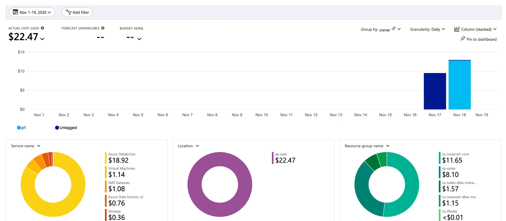 |
| Tag `stack` | 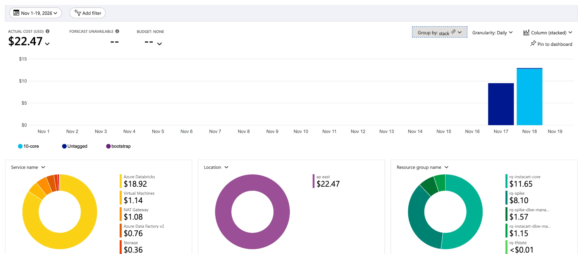 |
| Tag `cost_owner` | 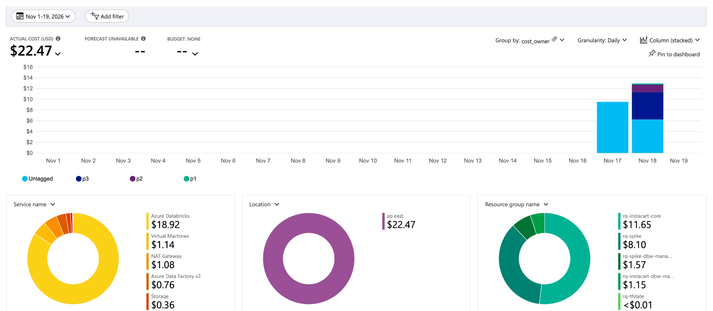 |

**Nhận xét:**
- **Khoảng 9,67 USD không có tag** là phần còn lại của giai đoạn spike: `rg-spike` (đã xóa) và `rg-spike-dbw-managed`. Đây là chi phí một lần, không lặp lại.
  - `rg-spike-dbw-managed` vẫn còn một storage account và một access connector, chỉ tốn vài cent mỗi ngày.
  - Muốn dọn RG này thì P1 làm tay trên portal.
- **Serverless SQL chiếm 67% tổng chi phí.** Riêng ngày 18/11, warehouse `wh-instacart-bi` tốn 8,95 USD, tức khoảng 3 giờ chạy ở cỡ 2X-Small.
  - Tag `cost_owner = p3` (5,06 USD) chính là warehouse này.
  - Phần DBU serverless không mang tag `cost_owner` nên nằm trong nhóm "(không có tag)".
- **Budget báo thấp hơn Cost analysis** (12,06 so với 22,47). Budget cập nhật chậm hơn vài giờ, và có thể chưa tính phần spike. Bảng §2 lấy số Cost analysis làm chuẩn.
- **Tốc độ tiêu:** ngày 18/11 tiêu 12,80 USD cho môi trường chính. Giữ tốc độ này thì credit còn lại khoảng 77 USD chỉ đủ 6 ngày. Phải làm ngay các mục 1–2 ở §5, không chờ chạm mốc 50%.

### 2026-11-26 (tuần 2)

Số lũy kế 01–26/11. Script chạy ngày 27/11, lúc Cost Management đã có đủ dữ liệu ngày 26/11.

**Chi phí theo ngày** (tổng các resource group). Ngày 17–19/11 đã được Azure cập nhật lại, cao hơn nhiều so với số ghi ở tuần 1:

| Ngày | USD |
|---|---:|
| 17/11 | 9,52 |
| 18/11 | 34,51 |
| 19/11 | 30,35 |
| 20/11 | 0,65 |
| 21/11 | 0,82 |
| 22/11 | 2,27 |
| 23/11 | 1,92 |
| 24/11 | 0,52 |
| 25/11 | 7,94 |
| 26/11 | 8,15 |

Tuần 20–26/11 tiêu **22,27 USD**, so với 74,38 USD của ba ngày 17–19/11.

| Tag `owner` | USD |
|---|---:|
| p1 | 86,99 |
| (không có tag) | 9,67 |

| Tag `stack` | USD |
|---|---:|
| 10-core | 86,99 |
| (không có tag) | 9,67 |

| Tag `cost_owner` | USD |
|---|---:|
| (không có tag) | 61,71 |
| p3 | 25,16 |
| p2 | 9,58 |
| p1 | 0,21 |

| Resource group | USD |
|---|---:|
| rg-instacart-core | 80,85 |
| rg-spike | 8,10 |
| rg-instacart-dbw-managed | 6,14 |
| rg-spike-dbw-managed | 1,57 |

| Meter | Số lượng | USD | Đơn giá |
|---|---:|---:|---:|
| Premium Serverless SQL DBU | 73,60 | 69,92 | 0,95 |
| Premium Automated Serverless Compute DBU | 24,50 | 12,74 | 0,52 |
| D4ds v4 (máy của job/pipeline cluster) | 15,88 giờ | 4,92 | 0,31 |
| Premium Advanced Compute Delta Live Tables DBU | 6,07 | 3,28 | 0,54 |
| Standard Gateway (NAT của workspace spike) | 23,90 giờ | 1,08 | 0,045 |
| P15 LRS Disk | | 0,90 | |
| Premium Interactive Serverless Compute DBU | 0,75 | 0,79 | 1,05 |
| Premium Jobs Compute DBU | 1,95 | 0,58 | 0,30 |
| Cloud Data Movement (ADF) | 2,10 | 0,53 | 0,25 |
| Hot Write Operations (storage) | | 0,52 | |
| Các meter khác (IP tĩnh, disk P10, đọc storage, truyền dữ liệu, Model Serving, ADF activity) | | 1,17 | |

**Warehouse `wh-instacart-bi`** (2X-Small, auto stop 2 phút). Cách ước tính giống tuần 1; cột "USD thật" lấy từ meter serverless SQL.

| Ngày | Số truy vấn | Số phiên | Giờ chạy ước tính | USD thật (Azure) | Chia theo thời gian truy vấn |
|---|---:|---:|---:|---:|---|
| 18/11 | 193 | 19 | 1,4 | 28,92 | người dùng khác 2: 44%; P1: 34%; service principal: 22% |
| 19/11 | 544 | 37 | 3,3 | 23,78 | người dùng khác 2: 80%; P1: 11%; service principal: 8% |
| 20/11 | 3 | 2 | 0,1 | 0,36 | người dùng khác 2: 100% |
| 22/11 | 25 | 2 | 0,2 | 0,62 | người dùng khác 3: 100% |
| 23/11 | 35 | 3 | 0,4 | 0,79 | người dùng khác 3: 62%; người dùng khác 2: 38% |
| 25/11 | 177 | 10 | 0,9 | 4,26 | người dùng khác 2: 66%; người dùng khác 3: 34% |
| 26/11 | 159 | 18 | 1,1 | 5,13 | người dùng khác 2: 63%; service principal: 31%; người dùng khác 1: 5% |

Ngày 18/11 tuần 1 ghi 8,95 USD vì lúc đó Azure mới có một phần dữ liệu. Số thật là 28,92 USD. Giờ chạy ước tính thấp hơn nhiều so với số tiền thật, nên cách ước tính theo lịch sử truy vấn không dùng được để tính tiền; chỉ dùng tỷ lệ để biết ai dùng nhiều.

| Job / pipeline (20–26/11) | Số lần chạy | Tổng phút |
|---|---:|---:|
| job `[dev người 1] instacart-ds-prepare` | 4 | 47 |
| pipeline `[dev người 3] instacart-stream-*` (4 bản nghiệm thu AD-ST-05/06/07 và bản chính) | 10 | 75 |
| job `[dev người 2] instacart-batch-medallion` | 2 | 30 |
| pipeline `[dev người 1] instacart-*-acceptance` (AD-DE-15, AD-DE-16, #215) | 7 | 49 |
| job `[dev người 1] instacart-benchmark-formats` | 1 | 16 |
| pipeline `instacart-batch` (prod) | 1 | 12 |
| Các job thử quyền và EDA (AD-OPS-21, AD-OPS-23, AD-DS-11, G1 #25) | 10 | 12 |
| Các job, pipeline còn lại | 3 | 4 |

Ảnh Cost analysis, 01–26/11, chia theo ngày, cột chồng:

| Nhóm theo | Ảnh |
|---|---|
| Tag `owner` | 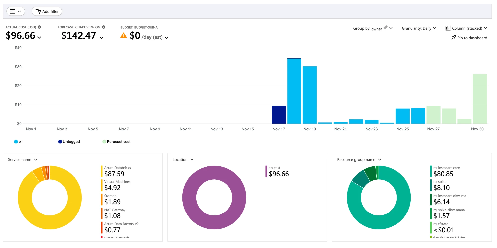 |
| Tag `stack` | 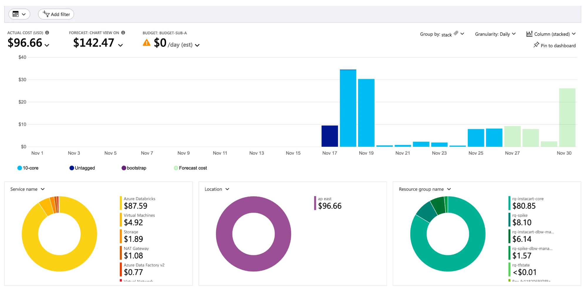 |
| Tag `cost_owner` | 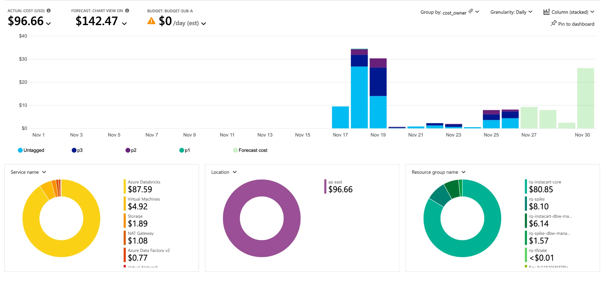 |

**Sub B** (P3 gửi ngày 27/11; Cost Management của Sub B có số tới 25/11):
- Lũy kế tháng 11: **0,19 USD**, toàn bộ là Event Hubs ở `koreacentral`, tag `stack = 20-stream`. Service Bus 0,00 USD.
- Chi phí chỉ phát sinh vào các ngày 21, 22 và 25/11, đúng những ngày bật stream để nghiệm thu. Ngày 25/11 tốn 0,04 USD, nằm trong `rg-instacart-stream`.
- Số lũy kế lấy ở scope billing account. Billing account này chỉ có một subscription là Sub B, nên số đó chính là chi phí Sub B.
- Sub B không có budget (budget chỉ đặt ở Sub A, stack `10-core`), nên không có email cảnh báo nào để chờ.

| Nội dung | Ảnh |
|---|---|
| Ngày 25/11, scope subscription | 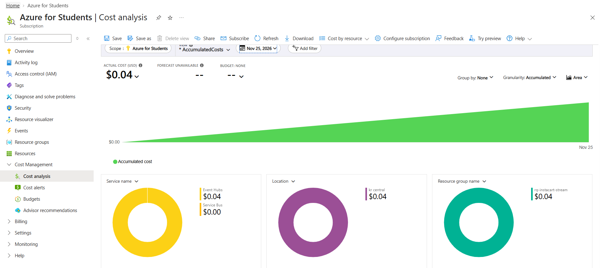 |
| Lũy kế tháng 11, scope billing account | 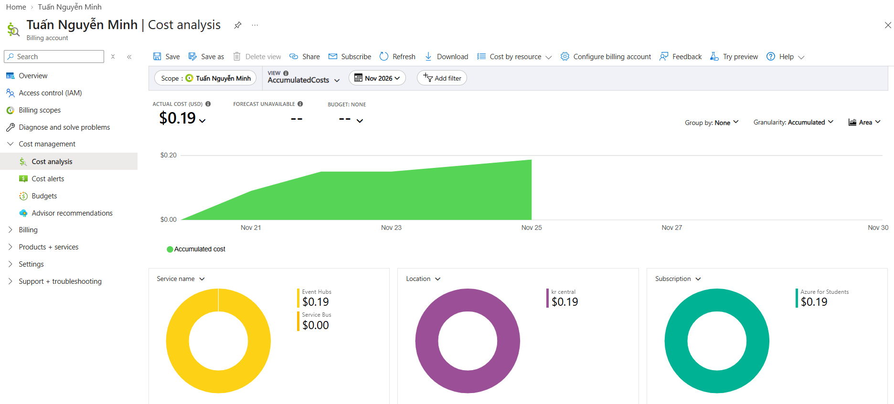 |
| Theo ngày, nhóm theo tag `stack` | 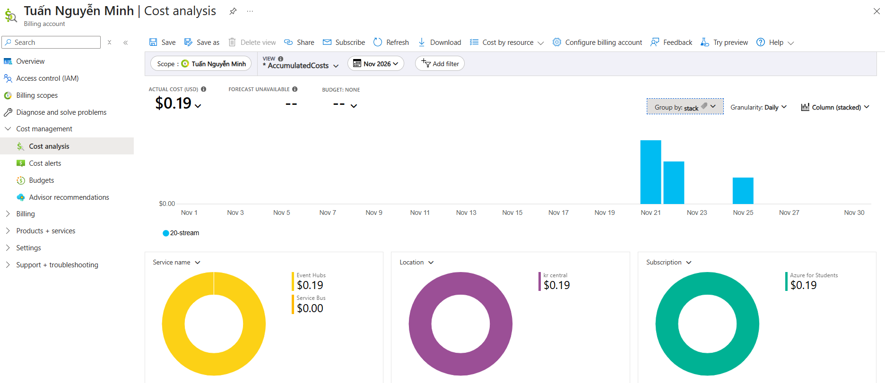 |

**Nhận xét:**
- **Credit Sub A gần hết:** đã tiêu 96,66/100 USD. Phần lớn rơi vào hai ngày 18–19/11 (64,86 USD), trước khi áp dụng quy tắc warehouse ở §6.
- **Quy tắc §6 có tác dụng:** chi phí warehouse giảm từ khoảng 26 USD/ngày (18–19/11) xuống dưới 1 USD/ngày (20–24/11).
  - Ngày 25–26/11 tăng lại lên khoảng 8 USD/ngày, do các đợt nghiệm thu: G1 #25, AD-DE-15/16, #215, AD-ST-05/06/07.
  - Trong đó warehouse chiếm 4–5 USD/ngày, phần còn lại là pipeline và job serverless.
- **Serverless SQL vẫn chiếm 72% tổng chi phí** (69,92/96,66 USD). Job và pipeline (serverless, DLT, máy D4ds v4) tốn khoảng 22 USD.
- **Sub B gần như không tốn tiền** (0,19 USD), nhờ `stream-toggle` tắt Event Hubs mỗi đêm. Đề xuất số 3 ở §5 đang có tác dụng.
- **Phần spike** (9,67 USD, không có tag) không đổi so với tuần 1: không còn phát sinh chi phí sau khi xóa `rg-spike`.
- **Email cảnh báo budget không tới:** budget đã báo tiêu 96%, tức đã qua cả bốn mốc 25/50/75/90%, nhưng P1 không thấy email nào trong hộp thư trường.
  - Cấu hình vẫn đúng: bốn mốc đều bật, gửi qua action group `ag-instacart-team`, cả 4 người nhận đều ở trạng thái `Enabled`.
  - Chưa rõ nguyên nhân. Cần kiểm thư mục Spam (người gửi `azure-noreply@microsoft.com`) và bấm *Test* trên action group (Portal → Monitor → Alerts → Action groups). Việc này còn treo từ bước nghiệm thu 10-core (`03_terraform_azure.md` bước 3.10).
  - Ở Sub D phải kiểm email test ngay sau khi apply `10-core`, trước khi dựa vào cảnh báo budget.
- **Chốt sau 2 tuần:** ngày 2026-11-27 nhóm quyết định không ghi tuần 3 (03/12) vì không kịp, AD-OPS-28 đóng với 2 tuần số liệu. Với tốc độ 8 USD/ngày, credit Sub A sẽ hết trước 03/12. Khi đó nhóm chuyển sang Sub D theo [runbook](chuyen_sang_sub_d.md), và chi phí tới lúc Sub A dừng đã sao lưu ở máy P1 (runbook §9).

## 4. Quota vCPU

Region Sub A là `eastasia`. Bằng chứng gồm ảnh trang *Quotas* bên dưới và bản chữ của `az vm list-usage`: [`evidence/2026-11-19_quota_vcpu_eastasia.txt`](evidence/2026-11-19_quota_vcpu_eastasia.txt).

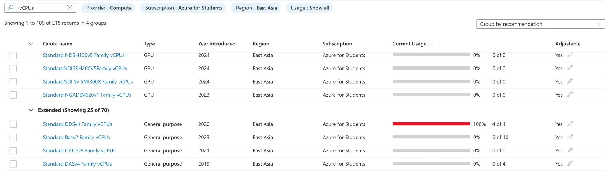

| Quota | Đang dùng | Giới hạn |
|---|---:|---:|
| Total Regional vCPUs | 4 | 6 |
| Standard DDSv4 Family vCPUs | 4 | 4 |

**Lần đo 2026-11-27**, ghi cho tuần 2: Total Regional vCPUs 0/6, Standard DDSv4 Family vCPUs 0/4. Không có cluster classic nào đang chạy. Bản chữ: [`evidence/2026-11-26_quota_vcpu_eastasia.txt`](evidence/2026-11-26_quota_vcpu_eastasia.txt). Ảnh trang *Quotas* chỉ hiện các họ máy, không có dòng tổng của region.

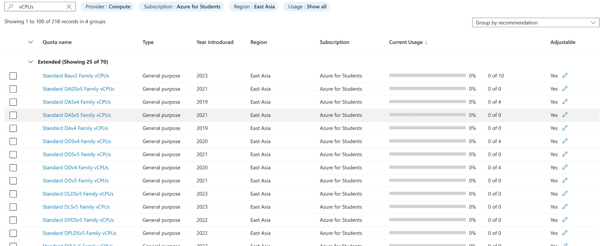

Lần đo 2026-11-19: lúc chụp có một cluster pipeline `Standard_D4ds_v4` (4 vCPU) đang chạy, nên họ DDSv4 đã đầy. Một job hoặc pipeline classic thứ hai sẽ không lên được cho tới khi cluster này tắt. Đây là lý do repo chỉ cho phép một cluster single-node mỗi lần (`bundles/AGENTS.md`, job seed).

## 5. Đề xuất cắt giảm

Nguyên tắc: làm mục 1–3 khi chạm mốc 50% (email budget 50 USD). Hiện tốc độ tiêu đang cao, nên mục 1–2 làm ngay.

| # | Việc | Ai | Tiết kiệm ước tính |
|---|---|---|---|
| 1 | **Đã làm:** giảm `auto_stop_mins` của `wh-instacart-bi` từ 10 xuống 5 phút (2026-11-19), rồi xuống 2 phút (2026-11-20, `30-databricks`). UI chỉ cho chọn từ 5 phút; Terraform đặt thấp hơn cho serverless | P1 | Mỗi lần warehouse rảnh tốn khoảng 0,09 USD thay vì 0,23 USD (5 phút) hay 0,47 USD (10 phút) |
| 2 | Không để Power BI hay dashboard tự refresh theo lịch ngắn trên warehouse. Report dùng Import, chỉ trang real-time mới dùng DirectQuery. Gom các truy vấn kiểm tra tay vào một lần | P3, mọi người | Phần lớn trong 9 USD/ngày của serverless SQL |
| 3 | Event Hubs (Sub B) chỉ bật trong buổi đo. `stream-toggle` đã tắt mỗi đêm; không bật lại ngoài buổi đo | P3 | Toàn bộ phí Standard TU ngoài giờ đo |
| 4 | Job và pipeline classic giữ đúng policy single-node; pipeline dev không bật `continuous` | P2, P3 | Tránh chạy liên tục 4 vCPU (khoảng 0,5 USD/giờ, gồm DBU) |
| 5 | Khi chạm 75%: tạm dừng job ADF theo lịch (`40-orchestration`), chỉ chạy tay lúc cần số liệu | P1 | Phí ADF và job cluster theo lịch |
| 6 | **Áp dụng từ 2026-11-20:** chỉ dùng warehouse ở bước nghiệm thu, theo quy tắc ở §6 | Mọi người | Phần truy vấn tay, khoảng 3/4 thời gian chạy warehouse ngày 18–19/11 |
| 7 | AD-DE-18 (#54) chuyển bốn bước SQL của job batch sang Spark serverless (§6.3) | P2 | Loại bốn lượt gọi warehouse trên mỗi job run. Chưa đo chi phí thực tế sau chuyển đổi |

## 6. Quy tắc dùng SQL warehouse

Áp dụng từ 2026-11-20. Lý do: warehouse `wh-instacart-bi` chiếm khoảng 2/3 chi phí tuần đầu (§3), và phần lớn là truy vấn tay rải rác trong ngày.

Thành viên có Contributor trên RG core nên thành admin workspace khi mở workspace từ Azure portal, vì vậy bỏ `CAN_USE` không chặn chắc được truy vấn. Giữ warehouse
để phục vụ đối soát, BI và các `sql_task` của job DS; bundle tra warehouse theo tên (`bundles/databricks.yml`,
biến `warehouse_id`) nên không xóa được tới cuối kỳ. Việc giới hạn thời gian chạy phụ thuộc vào cách nhóm sử dụng.

### 6.1 Cái gì bật warehouse

| Nguồn | Bật warehouse? | Ghi chú |
|---|---|---|
| `uv run pytest`, workflow `pr-checks`, `bundle validate` | Không | Test chạy Spark local |
| `de-deploy` (dev, prod), `tf-plan`, `tf-apply`, `drift-check` | Không | Chỉ deploy hoặc đọc cấu hình |
| Job `ds-prepare` | Không | Chạy SQL bằng Spark (`src/tasks/ds_prepare/run_sql.py`) |
| Pipeline `instacart_batch` chạy riêng | Không | Tốn cluster pipeline, không tốn warehouse |
| ADF `pl_master` | Chưa | Trigger đang tắt (`triggers_on = false`) |
| Job `instacart-batch-medallion`, cả bản `[dev …]` | Không | `resolve_pipeline_update`, `collect_dq`, `init_reconciliation`, `reconcile` chạy trên Spark serverless |
| Job `instacart-ds-benchmark` | **Có** | Ba `sql_task`: `ddl_ml`, `ingest_local`, `publish_gold` |
| SQL editor, tab *Sample data* của Catalog Explorer, notebook gắn warehouse, dashboard, Power BI | **Có** | Mỗi truy vấn giữ warehouse sống thêm 2 phút |

### 6.2 Quy tắc

1. **Khi đang viết code:** kiểm bằng `uv run pytest` và dữ liệu mẫu 1% ở máy. Không chạy truy vấn thử trên warehouse.
2. **Khi cần chạy thử trên cloud:**
   - Chỉ chạy pipeline (`databricks bundle run -t dev instacart_batch`), không chạy cả job `instacart-batch-medallion`.
   - Xem số dòng ghi và kết quả expectations ngay trên giao diện pipeline.
   - Không mở tab *Sample data* trong Catalog Explorer.
3. **Khi nghiệm thu** (code đã xong, chuẩn bị chuyển PR sang ready hoặc đóng task):
   - Gom mọi câu kiểm ở mục "Cách kiểm tra" của task vào **một** file `.sql`, chạy một lần trên warehouse, rồi dán kết quả vào PR.
   - Chạy cả job `instacart-batch-medallion` chỉ khi task cần kiểm chính các task vận hành (DQ, đối soát).
4. **Power BI:** làm mockup trên file xuất từ dữ liệu mẫu. Chỉ nối warehouse khi dựng semantic model thật, và theo §5 mục 2.
5. **Agent** (Claude Code, Codex…) không tự chạy truy vấn trên warehouse khi người dùng chưa nói là đang nghiệm thu.

### 6.3 Compute vận hành của job batch (AD-DE-18)

Job chạy đủ bốn bước SQL trên Spark serverless. Compute của pipeline batch vẫn theo policy single-node.
Chưa có số đo DBU hoặc chi phí thực tế sau chuyển đổi. Xem [runbook batch](../de/06_van_hanh_chay_lai.md#2-job-điều-phối-batch).
