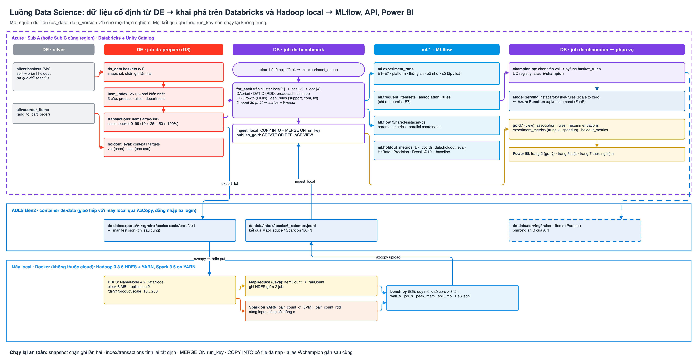

# 00 · Kế hoạch Data Science tổng quan

> Bộ tài liệu `docs/ds/` hướng dẫn **khai phá tập mục phổ biến và luật kết hợp** trên giỏ hàng Instacart. Phần này bám theo đề tài và bài báo nền tảng, rồi đưa kết quả vào MLflow, API model và Power BI.
> Dữ liệu đầu vào do DE chuẩn bị ([de/08](../de/08_du_lieu_cho_ds.md)). Hạ tầng do DevOps dựng ([devops/00](../devops/00_tong_quan.md)).

| Thứ tự đọc | File | Trả lời câu hỏi | Ai chính |
|---|---|---|---|
| 0 | `00_tong_quan_ds.md` (file này) | Đề tài, bám bài báo thế nào, luồng DS trên Azure + local, cổng, quy ước | Cả nhóm |
| 1 | [01_du_lieu_thuc_nghiem.md](01_du_lieu_thuc_nghiem.md) | DS nhận dữ liệu gì từ DE, khám phá dữ liệu, chọn ngưỡng | P4 |
| 2 | [02_thuat_toan_spark.md](02_thuat_toan_spark.md) | Cài DApriori, DATID, sinh luật, FP-Growth MLlib; kiểm tra đúng đắn | P4 (+ P2 review) |
| 3 | [03_hadoop_mapreduce_local.md](03_hadoop_mapreduce_local.md) | Cụm Hadoop HDFS + YARN bằng Docker, MapReduce so với Spark | P4 |
| 4 | [04_thuc_nghiem_danh_gia.md](04_thuc_nghiem_danh_gia.md) | Ma trận thực nghiệm, đo thời gian / bộ nhớ / speedup, đánh giá trên holdout | P4 |
| 5 | [05_mlflow_serving_bao_cao.md](05_mlflow_serving_bao_cao.md) | MLflow, chọn model champion, API, Power BI, checklist G5 | P4 + P1 |

---

## 1. Đề tài trong một trang

**Bài toán:** từ 3,2 triệu giỏ hàng `prior` của Instacart, tìm các **tập sản phẩm hay được mua cùng nhau** (frequent itemsets) và **luật kết hợp** `X → Y` đo bằng support, confidence, lift. Sau đó **đánh giá hiệu năng** của các thuật toán phân tán khi thay đổi:
- Quy mô dữ liệu.
- Ngưỡng MinSupport.
- Số item.
- Tài nguyên (số core).
- Nền tảng xử lý: Spark hay Hadoop MapReduce.

**Sản phẩm phải nộp** (theo mô tả đề tài):

| Sản phẩm | Ở đâu trong kế hoạch |
|---|---|
| Pipeline xử lý dữ liệu lớn bằng Hadoop HDFS và Apache Spark | Trên Azure: ADLS Gen2 + Databricks ([de/](../de/00_tong_quan_de.md)). Ở local: HDFS + YARN + Spark ([03](03_hadoop_mapreduce_local.md)) |
| Hệ thống khai phá bằng DApriori và FP-Growth | [02](02_thuat_toan_spark.md), chạy theo lưới tham số ở [04](04_thuc_nghiem_danh_gia.md) |
| Chương trình thống kê bằng Hadoop MapReduce | [03 §4](03_hadoop_mapreduce_local.md) |
| Bộ kết quả, báo cáo thực nghiệm, biểu đồ, demo | `ml.experiment_runs`, MLflow, Power BI trang 6–7 ([05](05_mlflow_serving_bao_cao.md)) |

**Phần thêm khi lên Azure** (rubric mục 4 "Phân tích"):
- Train và theo dõi thực nghiệm bằng MLflow.
- **API model**: gửi giỏ hàng, trả về món gợi ý.
- Trực quan kết quả theo tham số trên Power BI.

## 2. Bài báo nền tảng và mức độ bám sát

**Bài báo:** C. Fernandez-Basso, M. D. Ruiz, M. J. Martin-Bautista, *New Spark solutions for distributed frequent itemset and association rule mining algorithms*, Cluster Computing 27, 1217–1234 (2024), doi:[10.1007/s10586-023-04014-w](https://doi.org/10.1007/s10586-023-04014-w), open access.

**Bài báo làm gì:**

| Thành phần | Nội dung |
|---|---|
| Thuật toán tìm tập phổ biến | **DApriori**, **DATID** (theo Apriori-TID), **DECLAT** (theo ECLAT). Cả ba đều **exhaustive**, tức là trả về mọi tập có support ≥ MinSupp, và viết trên **RDD** bằng `flatMap` / `map` / `reduce` |
| Cách DApriori đếm | Pha 1 đếm item. Pha 2 **lặp theo k**: sinh ứng viên bậc k+1 từ tập phổ biến bậc k (downward closure), **broadcast ứng viên dạng hash table**, mỗi k chạy một lượt MapReduce. **Không giới hạn k** |
| DATID khác DApriori ở đâu | Sau pha 1, **xóa item không phổ biến khỏi giao dịch** và sắp theo support, rồi đếm trên dữ liệu đã thu gọn. Dùng 2 biến broadcast |
| Sinh luật | `map` trên từng partition sinh các luật kèm confidence, rồi `reduce` |
| So sánh với | YAFIM (nhóm tác giả tự cài) và PFP (FP-Growth trong Spark MLlib) |
| Dữ liệu | Poker 1M giao dịch / 78 item, Susy 5M, Higgs 11M, Otto 90K / 93 item. **Ít item, giao dịch dày** |
| Phần cứng | 32 core, 200 GB RAM |
| Chỉ số đo | Thời gian theo số giao dịch và **theo số item**, **bộ nhớ**, **speedup Sₙ = T₁/Tₙ**, **efficiency Eₙ = Sₙ/n**, **số luật** |
| Kết luận | PFP nhanh nhất. DATID tốn ít bộ nhớ nhất và là lựa chọn tốt nhất khi cần **đủ mọi luật**. Thời gian tăng **theo hàm mũ khi số item tăng**: Otto chỉ có 93 item mà chạy mất hàng giờ |

**Đối chiếu với đề tài và cách xử lý trong kế hoạch:**

| Điểm | Đề tài gốc | Bài báo | Kế hoạch này |
|---|---|---|---|
| DApriori trên Spark | Có | Có | Viết **bằng RDD**, đúng cấu trúc hai pha và broadcast hash set như bài ([02 §2](02_thuat_toan_spark.md)) |
| Giới hạn kích thước tập mục | "Giới hạn k nhỏ" | Không giới hạn | Bài không giới hạn vì dữ liệu chỉ có tới 93 item, còn Instacart có **49.688 sản phẩm**. Kế hoạch chạy **exhaustive** ở cấp *department* (21 item) và *aisle* (134 item), là hai cấp gần với điều kiện của bài. Ở cấp *product* thì đặt **k ≤ 3** và phải giải thích lý do trong báo cáo |
| DATID | Không có | Thuật toán được khuyên dùng | **Thêm vào.** Chỉ khác DApriori ở bước thu gọn giao dịch, công sức làm thêm nhỏ |
| DECLAT, YAFIM | Không có | Có | Không làm, chỉ ghi vào mục "hướng mở rộng". DECLAT tốn bộ nhớ nhất trong bài; YAFIM chỉ khác DApriori ở cấu trúc đếm |
| FP-Growth (PFP) | Có | Có | Dùng `pyspark.ml.fpm.FPGrowth`. **Kiểm chứng** nhận định "PFP không exhaustive" của bài: theo hiểu biết của nhóm, bản MLlib hiện tại trả về mọi tập ≥ minSupport. Kết quả so khớp ở [04 E1](04_thuc_nghiem_danh_gia.md) là một phát hiện đáng đưa vào báo cáo |
| Support / Confidence / Lift | Có | Support, Confidence | Thêm Lift (mở rộng) |
| Thực nghiệm theo số item | Không có | Có | **Thêm vào** (E4): top-N sản phẩm và 3 cấp phân loại |
| Bộ nhớ, speedup, efficiency | Ghi chung chung | Có công thức | Dùng **đúng công thức Sₙ, Eₙ** của bài |
| MapReduce so với Spark | Có | Chỉ lập luận, **không đo** | Đo thật trên **cùng một cụm YARN + HDFS** ở local (E6). Đây là phần bổ sung cho bài |
| Phần cứng | — | 32 core | Azure: 4 vCPU mỗi subscription. Local: 8 core trở lên. Đường speedup ngắn hơn bài, phải ghi rõ giới hạn |

## 3. Từ đề tài gốc lên Azure: cái gì ở đâu

| Đề tài gốc (trước Azure) | Kế hoạch hiện tại | Lý do |
|---|---|---|
| HDFS lưu dữ liệu | **ADLS Gen2** (HNS, giao thức ABFS tương thích Hadoop) làm kho chính trên Azure; **HDFS thật** trong cụm Docker local | Không có quota/credit cho cụm Hadoop trên Azure. HDInsight cần tối thiểu 2 head node và worker, vượt xa quota 4 vCPU |
| Spark SQL làm sạch, gom giỏ | Pipeline DE → `silver.baskets` → DE xuất dữ liệu thực nghiệm ([de/08](../de/08_du_lieu_cho_ds.md)) | Một nguồn dữ liệu chung cho cả cloud và local |
| DApriori, FP-Growth | Databricks: job `ds-benchmark` ([04](04_thuc_nghiem_danh_gia.md)) | |
| MapReduce đếm cặp | Local: Hadoop 3.3.6 MapReduce (Java) trên YARN, đặt cạnh **Spark on YARN** cùng cụm | So sánh công bằng: cùng máy, cùng HDFS, cùng bộ cấp tài nguyên |
| Biểu đồ, demo | Power BI trang 6–7, MLflow UI, API model | Rubric mục 4 |

## 4. Luồng DS end-to-end



<sub>File gốc: [diagrams/ds_diagrams.drawio](diagrams/ds_diagrams.drawio), trang 1.</sub>

| Bước | Việc | Ai | Chạy ở đâu | Tài liệu |
|---|---|---|---|---|
| D0 | **Snapshot** `silver.baskets` vào `ds_data.baskets` với `data_version = 'v1'`, cố định cho mọi thực nghiệm | DE (P2) | Sub A, job `ds-prepare` | [de/08 §2](../de/08_du_lieu_cho_ds.md) |
| D1 | Mã hóa item thành số nguyên, dựng giao dịch theo 3 cấp, tập holdout, **xuất file** txt ra container `ds-data` | DE (P2) | Sub A, job `ds-prepare` | [de/08 §3–5](../de/08_du_lieu_cho_ds.md) |
| D2 | Khám phá dữ liệu, chọn lưới MinSupport | DS (P4) | Databricks notebook | [01](01_du_lieu_thuc_nghiem.md) |
| D3 | Khai phá: DApriori, DATID, FP-Growth, sinh luật; **kiểm tra đúng đắn** | DS | Databricks, job `ds-benchmark` | [02](02_thuat_toan_spark.md), [04](04_thuc_nghiem_danh_gia.md) |
| D4 | Chạy lưới thực nghiệm E1–E5, E7 → `ml.experiment_runs`, MLflow | DS | Databricks | [04](04_thuc_nghiem_danh_gia.md) |
| D5 | **MapReduce và Spark** trên Hadoop local (E6) → upload kết quả lên `ds-data/inbox/` | DS (P4) | Máy local, Docker | [03](03_hadoop_mapreduce_local.md) |
| D6 | Chọn cấu hình champion, đóng gói model `pyfunc`, đăng ký UC, phục vụ qua API | DS + P1 | Databricks, Model Serving / Azure Functions | [05](05_mlflow_serving_bao_cao.md) |
| D7 | Công bố view `gold.*` cho Power BI: luật, gợi ý, kết quả thực nghiệm | DS (P4: view, trang 6–7) + BI (P3: semantic model) | Serverless SQL warehouse | [05 §4](05_mlflow_serving_bao_cao.md), [de/07](../de/07_power_bi.md) |

**Vì sao DS chạy job riêng, không gắn vào batch job hằng ngày** (hình kiến trúc 2 vẽ riêng dải "Job DS"):
- `ds_data.baskets` (`v1`) là bản cố định, nên không cần train lại mỗi đêm.
- Lưới thực nghiệm chạy hàng giờ trên 4 vCPU. Nếu gắn vào batch job, nó sẽ chặn pipeline DE và các buổi demo stream.

## 5. Cổng và mốc

Snapshot dev `v1` cho AD-DS-11 được tạo ngày 26/11/2026 trong `instacart.23521394_ad21_ds_data`.
Dùng [số liệu và đường dẫn export dev](../de/08_du_lieu_cho_ds.md#nghiệm-thu-v1-trên-dev).
Bản `v1` chính thức dùng schema prod sau khi G3 prod đạt.

| Cổng / mốc | Điều kiện vào | Việc | Xong khi |
|---|---|---|---|
| G0 | — | DS đọc bài báo; viết DApriori/DATID và test trên dữ liệu đồ chơi ở máy local; dựng thử cụm Hadoop Docker | Test đúng đắn trên dữ liệu đồ chơi đạt ([02 §6](02_thuat_toan_spark.md)) |
| **G3** | Silver đạt đối soát ([de/03 §9](../de/03_silver_cdc_scd_dq.md)) | DE chạy `ds-prepare` (D0, D1) | Checklist [de/08 §7](../de/08_du_lieu_cho_ds.md) đạt → **DS bắt đầu trên cloud** |
| DS-1 | G3 | D2 + spike hiệu năng: một lần chạy mỗi thuật toán ở 10% dữ liệu | Có ước lượng thời gian thật để chốt lưới ([04 §3](04_thuc_nghiem_danh_gia.md)) |
| DS-2 | DS-1 | E1 đúng đắn, rồi E2–E5 | Đủ dòng `ok` / `timeout` cho mọi tổ hợp trong lưới |
| DS-3 | Song song DS-2 | E6 trên Hadoop local | Kết quả local có trong `ml.experiment_runs` |
| DS-4 | DS-2 | E7 trên holdout, chọn champion, API | Endpoint (hoặc Function) trả lời được |
| **G5** | DS-2, DS-3, DS-4 | Power BI trang 6–7, báo cáo | Checklist [05 §6](05_mlflow_serving_bao_cao.md) đạt |

## 6. Quy ước chung

### 6.1 Tên bảng và schema

| Schema | Chủ | Bảng | Ghi chú |
|---|---|---|---|
| `ds_data` | DE | `data_versions`, `baskets`, `item_index`, `transactions`, `holdout_eval` | DS chỉ đọc. Có volume `exports`. Hai bảng `ds_prepare_products` và `ds_prepare_holdout` dùng nội bộ DE, DS không dùng ([de/08](../de/08_du_lieu_cho_ds.md)) |
| `ml` | DS | `experiment_runs`, `frequent_itemsets`, `association_rules`, `holdout_metrics`, `recommendations`; model `basket_rules` | Có volume `inbox` để nhận kết quả từ local |
| `gold` | DE cấp chỗ, DS định nghĩa view | View `association_rules`, `recommendations`, `experiment_metrics` | Power BI chỉ đọc `gold`. View chạy bằng quyền của chủ view, nên vai `bi` không cần quyền vào `ml` |

> Bản đầu của hình kiến trúc ghi `gold.benchmark_results` cho kết quả MapReduce/Spark. Tên này đã được dùng cho benchmark định dạng file (`ops.benchmark_results`, [de/05 §5.1](../de/05_gold_serving.md)). Vì vậy kết quả DS dùng tên **`gold.experiment_metrics`**, có cột `platform` để phân biệt Databricks, Spark on YARN và MapReduce.

### 6.2 Khóa của một lần chạy

Mỗi lần chạy thực nghiệm có một `run_key`, là hash của tất cả tham số ảnh hưởng tới kết quả:

```
run_key = sha1(experiment | platform | algo | grain | scale_pct | top_n | min_support | min_confidence | max_k | cores | rep | data_version | algo_version)
```

- Ghi kết quả bằng `MERGE … ON run_key`. Chạy lại cùng tổ hợp sẽ ghi đè đúng dòng của nó, không sinh dòng thứ hai.
- Kế hoạch chạy bỏ qua tổ hợp đã có `status = 'ok'`. Nhờ vậy job chạy lưới bị đứt giữa chừng có thể chạy lại mà không làm lại phần đã xong ([04 §6](04_thuc_nghiem_danh_gia.md)).
- `rep` (lần lặp 1–3) nằm trong khóa: thời gian đo 3 lần, báo cáo lấy **trung vị**.

### 6.3 Mã hóa item

DE đánh số item thành `idx` liên tục, **xếp theo tần suất giảm dần** trong split `prior` (0 là item phổ biến nhất).

Hệ quả:
- Giỏ hàng là `array<int>` nhỏ gọn; broadcast và so sánh tuple rẻ hơn dùng `product_id`.
- **"Top-N item" chỉ là phép lọc `idx < N`**, không cần dựng bảng riêng cho thí nghiệm theo số item (E4).
- File txt cho Hadoop có mỗi dòng là `idx` cách nhau bằng dấu cách. Spark và MapReduce đọc **cùng một file**.

## 7. Phân vai

| Người | Phần DS |
|---|---|
| P4 | Chủ trì toàn bộ DS: thuật toán, cụm Hadoop Docker + MapReduce Java (E6), thực nghiệm, MLflow, Power BI trang 6–7, báo cáo |
| P2 | Job `ds-prepare` (D0–D1); review code PySpark của DS |
| P3 | Chủ Power BI: mở rộng semantic model cho view DS (AD-BI-11) để P4 dựng trang 6–7 |
| P1 | Hạ tầng: container `ds-data`, schema, policy, MLflow, serving endpoint, Azure Function ([devops/05](../devops/05_databricks_platform.md), [devops/03](../devops/03_terraform_azure.md)) |

## 8. Cấu trúc code

```
src/ml/
├── fim/
│   ├── apriori_gen.py        # sinh ứng viên + tỉa (hàm thuần, có test)
│   ├── dapriori.py           # DApriori trên RDD
│   ├── datid.py              # DATID trên RDD
│   ├── rules.py              # sinh luật phân tán (support, confidence, lift)
│   └── fpgrowth.py           # bọc pyspark.ml.fpm.FPGrowth, chuẩn hóa đầu ra
├── data.py                   # đọc ds_data.transactions theo grain/scale/top_n
├── measure.py                # đo thời gian, bộ nhớ đỉnh, timeout
├── plan_grid.py              # task "plan" của job: sinh danh sách tổ hợp chưa chạy
├── run_experiment.py         # một tổ hợp → ml.experiment_runs + MLflow
├── evaluate_holdout.py       # E7: hit-rate@k, precision@k, coverage
├── champion.py               # đóng gói pyfunc, đăng ký UC, alias @champion
├── experiments.yml           # định nghĩa lưới E1–E7
└── sql/publish_gold.sql      # view gold.* cho Power BI
src/mapreduce/                # Maven: PairCount, AprioriMR (Java 11, Hadoop 3.3.6)
local/hadoop/                 # Dockerfile, docker-compose.yml, conf/*.xml, scripts/
bundles/resources/jobs_ds.yml # job ds-benchmark, ds-champion (+ ds-prepare của DE)
tests/ml/                     # pytest: apriori_gen, DApriori = DATID = FPGrowth trên dữ liệu đồ chơi
```
