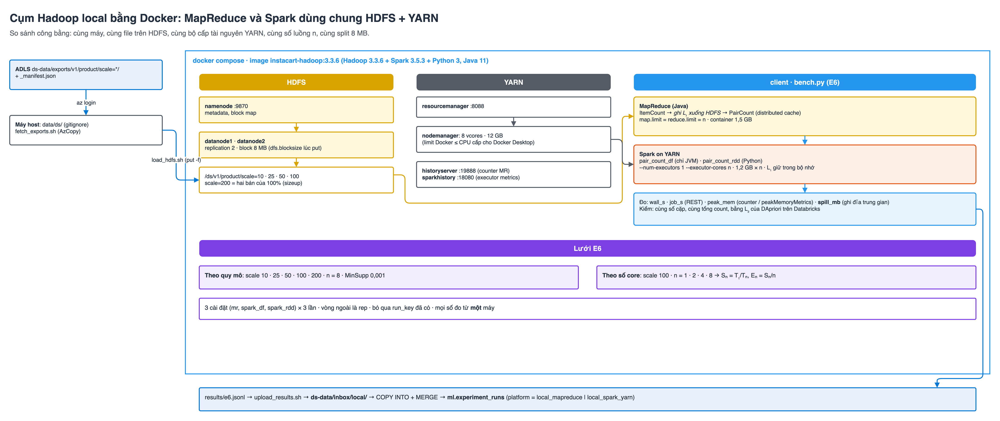

# 03 · Hadoop HDFS + MapReduce ở máy local, so với Spark trên cùng cụm

**Đầu vào:**
- File txt giao dịch DE xuất ra ở `ds-data/exports/v1/product/scale=<pct>/` ([de/08 §5](../de/08_du_lieu_cho_ds.md)).
- Docker Desktop cấp cho VM của Docker **≥ 8 CPU, ≥ 16 GB RAM**.
- Azure CLI và AzCopy trên máy, tài khoản đã có quyền *Storage Blob Data Contributor* trên storage `lake` ([devops/03 §3.8](../devops/03_terraform_azure.md)).

**Đầu ra:**
- Cụm Hadoop 3.3.6 trong Docker: HDFS (1 NameNode, 2 DataNode) + YARN + JobHistory, cùng Spark 3.5 chạy trên YARN.
- Chương trình MapReduce Java: `ItemCount`, `PairCount`.
- Kết quả thực nghiệm **E6** dạng JSONL, đã upload vào `ds-data/inbox/` và nạp vào `ml.experiment_runs`.

**Xong khi:**
- `PairCount` (MapReduce), `pair_count_rdd.py` và `pair_count_df.py` (Spark) cho **cùng tập cặp phổ biến**.
- Lưới E6 có đủ 3 lần đo cho mỗi tổ hợp.
- Có ảnh chụp `hdfs fsck` (block, replication) và YARN UI cho báo cáo.

---

## 1. Vì sao chạy local và chạy thế nào cho công bằng

**Đặt ở local, không đặt trên Azure:**
- Một cụm HDInsight tối thiểu cần 2 head node và worker, vượt xa quota 4 vCPU, và tốn tiền cả khi không chạy.
- Sub D là subscription **dự phòng**, dùng để dựng lại hạ tầng khi Sub A/B hết credit; không đặt VM lên đó.
- Laptop thường có ≥ 8 core, nên đường speedup đo được tới n = 8. Trên Azure, quota 4 vCPU chỉ cho đo tới n = 4.

**Nguyên tắc so sánh công bằng giữa MapReduce và Spark:**

| Yếu tố | MapReduce | Spark | Vì sao |
|---|---|---|---|
| Phần cứng | Cùng một máy, cùng cụm Docker | Như bên trái | Loại trừ khác biệt máy |
| Lưu trữ | Đọc HDFS | Đọc **cùng file** trên HDFS | Cùng I/O đầu vào |
| Bộ cấp tài nguyên | YARN | **Spark on YARN** (không dùng standalone) | Cùng cách cấp container và bộ nhớ |
| Số luồng song song n | `mapreduce.job.running.map.limit = n`, `…reduce.limit = n` | `--num-executors 1 --executor-cores n` | Cùng số task chạy đồng thời |
| Bộ nhớ mỗi luồng | Container 1,5 GB | `executor-memory` = n × 1,2 GB (+ overhead) | Gần bằng nhau trên mỗi luồng |
| Chia input | `dfs.blocksize = 8m` khi `put` → mỗi block một split | `spark.sql.files.maxPartitionBytes = 8m`; `textFile` theo block | Cùng số partition đầu vào |
| Thuật toán | Pha 1 đếm item → pha 2 đếm cặp của item phổ biến | Giống hệt | Cùng khối lượng tính toán |
| Ngôn ngữ | Java | Có 2 bản: **DataFrame** (chạy trên JVM, so ngang với Java) và **RDD Python** (bám code DApriori) | Tách riêng chi phí của Python |

> Standalone Spark (như bản đầu của hình kiến trúc) vẫn chạy được trong cùng image, dùng làm mốc phụ. Số liệu chính để so với MapReduce là **Spark on YARN**.



<sub>File gốc: [diagrams/ds_diagrams.drawio](diagrams/ds_diagrams.drawio), trang 3.</sub>

## 2. Dựng cụm bằng Docker

### 2.1 Cấu trúc thư mục

```
local/hadoop/
├── Dockerfile               # 1 image dùng cho mọi vai: Hadoop 3.3.6 + Spark 3.5.3 + Python 3 + Java 11
├── docker-compose.yml
├── conf/                    # chép vào /opt/hadoop/etc/hadoop lúc build (sửa xong: docker compose build)
│   ├── core-site.xml
│   ├── hdfs-site.xml
│   ├── yarn-site.xml
│   └── mapred-site.xml
├── spark-defaults.conf      # chép vào /opt/spark/conf lúc build
├── entrypoint.sh            # format NameNode lần đầu, rồi chạy daemon theo vai
└── scripts/
    ├── fetch_exports.sh     # AzCopy: ds-data/exports → ./data/ds (máy host)
    ├── load_hdfs.sh         # put lên HDFS với block 8 MB, tạo bản 200%
    ├── bench.py             # chạy lưới E6, ghi results/*.jsonl
    └── upload_results.sh    # AzCopy: results → ds-data/inbox/local/
```

Dữ liệu tải về đặt ở `data/ds/` tại gốc repo. Thư mục `/data/` đã nằm trong `.gitignore`.

### 2.2 Image

```dockerfile
# local/hadoop/Dockerfile
FROM eclipse-temurin:11-jre-jammy

ARG HADOOP_VERSION=3.3.6
ARG SPARK_VERSION=3.5.3
ENV HADOOP_HOME=/opt/hadoop SPARK_HOME=/opt/spark \
    HADOOP_CONF_DIR=/opt/hadoop/etc/hadoop YARN_CONF_DIR=/opt/hadoop/etc/hadoop \
    PYSPARK_PYTHON=python3
ENV PATH=$PATH:$HADOOP_HOME/bin:$HADOOP_HOME/sbin:$SPARK_HOME/bin

RUN apt-get update && apt-get install -y --no-install-recommends curl python3 python3-pip procps \
    && rm -rf /var/lib/apt/lists/* && pip3 install --no-cache-dir psutil==5.9.8

# Tải từ archive chính thức của Apache, kiểm SHA-512 trước khi giải nén
RUN set -eux; cd /tmp; \
    curl -fsSLO https://archive.apache.org/dist/hadoop/common/hadoop-${HADOOP_VERSION}/hadoop-${HADOOP_VERSION}.tar.gz; \
    curl -fsSLO https://archive.apache.org/dist/hadoop/common/hadoop-${HADOOP_VERSION}/hadoop-${HADOOP_VERSION}.tar.gz.sha512; \
    sha512sum -c hadoop-${HADOOP_VERSION}.tar.gz.sha512; \
    tar -xzf hadoop-${HADOOP_VERSION}.tar.gz -C /opt && mv /opt/hadoop-${HADOOP_VERSION} $HADOOP_HOME; \
    curl -fsSLO https://archive.apache.org/dist/spark/spark-${SPARK_VERSION}/spark-${SPARK_VERSION}-bin-hadoop3.tgz; \
    curl -fsSLO https://archive.apache.org/dist/spark/spark-${SPARK_VERSION}/spark-${SPARK_VERSION}-bin-hadoop3.tgz.sha512; \
    sha512sum -c spark-${SPARK_VERSION}-bin-hadoop3.tgz.sha512; \
    tar -xzf spark-${SPARK_VERSION}-bin-hadoop3.tgz -C /opt && mv /opt/spark-${SPARK_VERSION}-bin-hadoop3 $SPARK_HOME; \
    rm -f /tmp/*.tgz /tmp/*.tar.gz /tmp/*.sha512

# Ghi đè 4 file cấu hình, giữ nguyên các file mặc định khác (log4j, capacity-scheduler.xml…)
COPY conf/*.xml $HADOOP_HOME/etc/hadoop/
COPY spark-defaults.conf $SPARK_HOME/conf/spark-defaults.conf
COPY entrypoint.sh /entrypoint.sh
RUN chmod +x /entrypoint.sh
ENTRYPOINT ["/entrypoint.sh"]
```

- File `.sha512` của Apache có định dạng `<tên file>: <hash>` (dạng BSD). Nếu `sha512sum -c` báo sai định dạng, thay bằng phép so `sha512sum <file> | cut -d' ' -f1` với hash trong file. **Không** bỏ bước kiểm tra.
- Mọi container (NodeManager và client) có **cùng phiên bản Python**, điều kiện bắt buộc để PySpark chạy trên YARN.

```bash
# local/hadoop/entrypoint.sh
#!/usr/bin/env bash
set -euo pipefail
case "${1:-client}" in
  namenode)
    [ -d /hadoop/nn/current ] || hdfs namenode -format -nonInteractive -clusterId instacart
    exec hdfs namenode ;;
  datanode)        exec hdfs datanode ;;
  resourcemanager) exec yarn resourcemanager ;;
  nodemanager)     exec yarn nodemanager ;;
  historyserver)   exec mapred historyserver ;;
  sparkhistory)    exec spark-class org.apache.spark.deploy.history.HistoryServer ;;
  client)          exec sleep infinity ;;
  *)               exec "$@" ;;
esac
```

### 2.3 Docker Compose

```yaml
# local/hadoop/docker-compose.yml
x-hadoop: &hadoop
  build: .
  image: instacart-hadoop:3.3.6

services:
  namenode:
    <<: *hadoop
    command: namenode
    hostname: namenode
    ports: ["9870:9870"]                  # HDFS UI
    volumes: ["nn:/hadoop/nn"]
  datanode1:
    <<: *hadoop
    command: datanode
    hostname: datanode1
    volumes: ["dn1:/hadoop/dn"]
  datanode2:
    <<: *hadoop
    command: datanode
    hostname: datanode2
    volumes: ["dn2:/hadoop/dn"]
  resourcemanager:
    <<: *hadoop
    command: resourcemanager
    hostname: resourcemanager
    ports: ["8088:8088"]                  # YARN UI
  nodemanager:
    <<: *hadoop
    command: nodemanager
    hostname: nodemanager
    deploy:
      resources:
        limits: { cpus: "8", memory: 14g }
  historyserver:
    <<: *hadoop
    command: historyserver
    hostname: historyserver
    ports: ["19888:19888"]                # MapReduce JobHistory UI + REST
  sparkhistory:
    <<: *hadoop
    command: sparkhistory
    hostname: sparkhistory
    ports: ["18080:18080"]                # Spark History UI + REST
  client:
    <<: *hadoop
    command: client
    hostname: client
    working_dir: /work
    volumes:
      - ../../data/ds:/data/ds:ro         # file đã tải từ ADLS
      - ../../src/mapreduce/target:/work/jars:ro
      - ../../src/ml/local:/work/spark:ro
      - ./scripts:/work/scripts:ro
      - ./results:/work/results

volumes: { nn: {}, dn1: {}, dn2: {} }
```

`limits.cpus: "8"` của NodeManager phải **≤ số CPU cấp cho Docker Desktop**. Máy có ít CPU hơn thì hạ xuống, và lưới `cores` ở mục 5 chỉ đi tới giá trị đó.

### 2.4 Cấu hình Hadoop và Spark

```xml
<!-- local/hadoop/conf/core-site.xml -->
<configuration>
  <property><name>fs.defaultFS</name><value>hdfs://namenode:8020</value></property>
</configuration>
```

```xml
<!-- local/hadoop/conf/hdfs-site.xml -->
<configuration>
  <property><name>dfs.replication</name><value>2</value></property>
  <property><name>dfs.namenode.name.dir</name><value>/hadoop/nn</value></property>
  <property><name>dfs.datanode.data.dir</name><value>/hadoop/dn</value></property>
  <property><name>dfs.permissions.enabled</name><value>false</value></property>
  <property><name>dfs.namenode.datanode.registration.ip-hostname-check</name><value>false</value></property>
</configuration>
```

```xml
<!-- local/hadoop/conf/yarn-site.xml -->
<configuration>
  <property><name>yarn.resourcemanager.hostname</name><value>resourcemanager</value></property>
  <property><name>yarn.nodemanager.aux-services</name><value>mapreduce_shuffle</value></property>
  <property><name>yarn.nodemanager.resource.memory-mb</name><value>12288</value></property>
  <property><name>yarn.nodemanager.resource.cpu-vcores</name><value>8</value></property>
  <property><name>yarn.scheduler.maximum-allocation-mb</name><value>12288</value></property>
  <property><name>yarn.nodemanager.vmem-check-enabled</name><value>false</value></property>
  <property><name>yarn.log-aggregation-enable</name><value>true</value></property>
  <property><name>yarn.nodemanager.env-whitelist</name>
    <value>JAVA_HOME,HADOOP_COMMON_HOME,HADOOP_HDFS_HOME,HADOOP_CONF_DIR,CLASSPATH_PREPEND_DISTCACHE,HADOOP_YARN_HOME,HADOOP_HOME,PATH,LANG,TZ,HADOOP_MAPRED_HOME</value></property>
</configuration>
```

```xml
<!-- local/hadoop/conf/mapred-site.xml -->
<configuration>
  <property><name>mapreduce.framework.name</name><value>yarn</value></property>
  <property><name>yarn.app.mapreduce.am.env</name><value>HADOOP_MAPRED_HOME=/opt/hadoop</value></property>
  <property><name>mapreduce.map.env</name><value>HADOOP_MAPRED_HOME=/opt/hadoop</value></property>
  <property><name>mapreduce.reduce.env</name><value>HADOOP_MAPRED_HOME=/opt/hadoop</value></property>
  <property><name>mapreduce.map.memory.mb</name><value>1536</value></property>
  <property><name>mapreduce.map.java.opts</name><value>-Xmx1228m</value></property>
  <property><name>mapreduce.reduce.memory.mb</name><value>1536</value></property>
  <property><name>mapreduce.reduce.java.opts</name><value>-Xmx1228m</value></property>
  <property><name>mapreduce.jobhistory.address</name><value>historyserver:10020</value></property>
  <property><name>mapreduce.jobhistory.webapp.address</name><value>historyserver:19888</value></property>
</configuration>
```

```properties
# local/hadoop/spark-defaults.conf
spark.master                              yarn
spark.submit.deployMode                   client
spark.eventLog.enabled                    true
spark.eventLog.dir                        hdfs://namenode:8020/spark-logs
spark.history.fs.logDirectory             hdfs://namenode:8020/spark-logs
spark.executor.processTreeMetrics.enabled true
spark.sql.files.maxPartitionBytes         8m
spark.sql.adaptive.enabled                false
spark.ui.showConsoleProgress              false
```

`spark.sql.adaptive.enabled = false` giữ số partition cố định giữa các lần đo. AQE gộp partition một cách khác nhau tùy dữ liệu, làm phép so tốc độ theo số core khó lặp lại.

### 2.5 Khởi động và kiểm tra

```bash
cd local/hadoop && docker compose up -d --build
docker compose exec client hdfs dfs -mkdir -p /spark-logs /ds
docker compose exec client hdfs dfsadmin -report          # thấy 2 DataNode "Live"
docker compose exec client yarn node -list                # thấy 1 NodeManager, 8 vcores
docker compose exec client hadoop jar /opt/hadoop/share/hadoop/mapreduce/hadoop-mapreduce-examples-3.3.6.jar pi 4 1000
```

UI: HDFS `http://localhost:9870`, YARN `http://localhost:8088`, JobHistory `http://localhost:19888`, Spark History `http://localhost:18080`.

## 3. Đưa dữ liệu vào HDFS

```bash
# local/hadoop/scripts/fetch_exports.sh  (chạy trên máy host, đã az login)
#!/usr/bin/env bash
set -euo pipefail
: "${LAKE_ACCOUNT:?đặt LAKE_ACCOUNT = tên storage account lake (output của 10-core)}"
export AZCOPY_AUTO_LOGIN_TYPE=AZCLI                       # dùng phiên az login, không cần key/SAS
for s in 10 25 50 100; do
  azcopy copy "https://${LAKE_ACCOUNT}.blob.core.windows.net/ds-data/exports/v1/product/scale=${s}/*.txt" \
              "data/ds/v1/product/scale=${s}/" --recursive=false
done
azcopy copy "https://${LAKE_ACCOUNT}.blob.core.windows.net/ds-data/exports/v1/_manifest.json" "data/ds/v1/"
```

```bash
# local/hadoop/scripts/load_hdfs.sh  (chạy trong container client)
#!/usr/bin/env bash
set -euo pipefail
for s in 10 25 50 100; do
  hdfs dfs -mkdir -p /ds/v1/product/scale=$s
  hdfs dfs -D dfs.blocksize=8m -put -f /data/ds/v1/product/scale=$s/*.txt /ds/v1/product/scale=$s/
done
# 200% = hai bản của 100% (sizeup, giữ nguyên support)
hdfs dfs -mkdir -p /ds/v1/product/scale=200
for f in $(hdfs dfs -ls -C /ds/v1/product/scale=100/); do
  b=$(basename "$f")
  hdfs dfs -D dfs.blocksize=8m -cp -f "$f" /ds/v1/product/scale=200/a_$b
  hdfs dfs -D dfs.blocksize=8m -cp -f "$f" /ds/v1/product/scale=200/b_$b
done
hdfs dfs -count -h /ds/v1/product/*                                   # số file, dung lượng
hdfs fsck /ds/v1/product/scale=100 -files -blocks -locations | tail -20   # ảnh chụp cho báo cáo
```

**Kiểm tra số dòng** khớp với `_manifest.json` của DE (số giao dịch theo từng `scale`):

```bash
for s in 10 25 50 100; do echo "$s $(hdfs dfs -cat /ds/v1/product/scale=$s/*.txt | wc -l)"; done
```

`put -f` ghi đè đúng file cũ. Chạy lại script bao nhiêu lần thì HDFS cũng chỉ có một bản của mỗi file.

## 4. Chương trình MapReduce (Java)

### 4.1 Tác vụ so sánh

"Thống kê tần suất cặp sản phẩm" trong đề tài được hiểu chính xác là **hai pha đầu của Apriori** (k = 2). Dùng thêm ngưỡng thì kết quả so được với DApriori trên Databricks:
1. **Pha 1, `ItemCount`:** đếm item, giữ item có `count ≥ min_count`.
2. **Pha 2, `PairCount`:** mỗi giỏ chỉ giữ item phổ biến (nạp qua *distributed cache*), sinh mọi cặp (a < b), đếm, giữ cặp có `count ≥ min_count`.

Cặp `(a, b)` được nén thành một `long` = `(a << 32) | b`. Cách này nhanh hơn dùng `Text` làm khóa. Spark cũng làm đúng như vậy ở bản DataFrame.

### 4.2 Code

```xml
<!-- src/mapreduce/pom.xml (phần chính) -->
<project xmlns="http://maven.apache.org/POM/4.0.0">
  <modelVersion>4.0.0</modelVersion>
  <groupId>instacart</groupId>
  <artifactId>instacart-mr</artifactId>
  <version>1.0</version>
  <properties>
    <maven.compiler.release>11</maven.compiler.release>
    <hadoop.version>3.3.6</hadoop.version>
  </properties>
  <dependencies>
    <dependency>
      <groupId>org.apache.hadoop</groupId>
      <artifactId>hadoop-client</artifactId>
      <version>${hadoop.version}</version>
      <scope>provided</scope>
    </dependency>
    <dependency>
      <groupId>org.apache.hadoop</groupId>
      <artifactId>hadoop-minicluster</artifactId>
      <version>${hadoop.version}</version>
      <scope>test</scope>
    </dependency>
    <dependency>
      <groupId>junit</groupId>
      <artifactId>junit</artifactId>
      <version>4.13.2</version>
      <scope>test</scope>
    </dependency>
  </dependencies>
</project>
```

```java
// src/mapreduce/src/main/java/instacart/mr/MinCountReducer.java
package instacart.mr;

import java.io.IOException;
import org.apache.hadoop.io.LongWritable;
import org.apache.hadoop.mapreduce.Reducer;

/** Cộng dồn và chỉ giữ khóa có tổng >= instacart.min.count. Combiner dùng LongSumReducer có sẵn. */
public class MinCountReducer<K> extends Reducer<K, LongWritable, K, LongWritable> {
  private long minCount;
  private final LongWritable out = new LongWritable();

  @Override
  protected void setup(Context ctx) {
    minCount = ctx.getConfiguration().getLong("instacart.min.count", 1L);
  }

  @Override
  protected void reduce(K key, Iterable<LongWritable> values, Context ctx) throws IOException, InterruptedException {
    long sum = 0;
    for (LongWritable v : values) {
      sum += v.get();
    }
    if (sum >= minCount) {
      out.set(sum);
      ctx.write(key, out);
    }
  }
}
```

```java
// src/mapreduce/src/main/java/instacart/mr/ItemCount.java
package instacart.mr;

import java.io.IOException;
import org.apache.hadoop.conf.Configured;
import org.apache.hadoop.fs.Path;
import org.apache.hadoop.io.IntWritable;
import org.apache.hadoop.io.LongWritable;
import org.apache.hadoop.io.Text;
import org.apache.hadoop.mapreduce.Job;
import org.apache.hadoop.mapreduce.Mapper;
import org.apache.hadoop.mapreduce.lib.input.FileInputFormat;
import org.apache.hadoop.mapreduce.lib.output.FileOutputFormat;
import org.apache.hadoop.mapreduce.lib.reduce.LongSumReducer;
import org.apache.hadoop.util.Tool;
import org.apache.hadoop.util.ToolRunner;

/** Pha 1: <item, 1> → tổng → lọc theo min_count. Dùng 1 reducer để ra đúng một file cho distributed cache. */
public class ItemCount extends Configured implements Tool {

  public static class ItemMapper extends Mapper<LongWritable, Text, IntWritable, LongWritable> {
    private static final LongWritable ONE = new LongWritable(1);
    private final IntWritable item = new IntWritable();

    @Override
    protected void map(LongWritable offset, Text line, Context ctx) throws IOException, InterruptedException {
      for (String tok : line.toString().trim().split(" ")) {
        if (!tok.isEmpty()) {
          item.set(Integer.parseInt(tok));
          ctx.write(item, ONE);
        }
      }
    }
  }

  public static class ItemReducer extends MinCountReducer<IntWritable> {}

  @Override
  public int run(String[] args) throws Exception {          // args: <input> <output> <min_count>
    getConf().setLong("instacart.min.count", Long.parseLong(args[2]));
    Job job = Job.getInstance(getConf(), "item-count");
    job.setJarByClass(ItemCount.class);
    job.setMapperClass(ItemMapper.class);
    job.setCombinerClass(LongSumReducer.class);
    job.setReducerClass(ItemReducer.class);
    job.setNumReduceTasks(1);
    job.setOutputKeyClass(IntWritable.class);
    job.setOutputValueClass(LongWritable.class);
    FileInputFormat.addInputPath(job, new Path(args[0]));
    FileOutputFormat.setOutputPath(job, new Path(args[1]));
    return job.waitForCompletion(true) ? 0 : 1;
  }

  public static void main(String[] args) throws Exception {
    System.exit(ToolRunner.run(new ItemCount(), args));
  }
}
```

```java
// src/mapreduce/src/main/java/instacart/mr/PairCount.java
package instacart.mr;

import java.io.BufferedReader;
import java.io.FileReader;
import java.io.IOException;
import java.net.URI;
import java.util.HashSet;
import java.util.Set;
import org.apache.hadoop.conf.Configured;
import org.apache.hadoop.fs.Path;
import org.apache.hadoop.io.LongWritable;
import org.apache.hadoop.io.Text;
import org.apache.hadoop.mapreduce.Job;
import org.apache.hadoop.mapreduce.Mapper;
import org.apache.hadoop.mapreduce.lib.input.FileInputFormat;
import org.apache.hadoop.mapreduce.lib.output.FileOutputFormat;
import org.apache.hadoop.mapreduce.lib.reduce.LongSumReducer;
import org.apache.hadoop.util.Tool;
import org.apache.hadoop.util.ToolRunner;

/** Pha 2: giữ item phổ biến (distributed cache) → sinh cặp a<b, nén thành long → tổng → lọc. */
public class PairCount extends Configured implements Tool {

  public static class PairMapper extends Mapper<LongWritable, Text, LongWritable, LongWritable> {
    private static final LongWritable ONE = new LongWritable(1);
    private final LongWritable pair = new LongWritable();
    private final Set<Integer> frequent = new HashSet<>();

    @Override
    protected void setup(Context ctx) throws IOException {
      // File cache được symlink vào thư mục làm việc của task với tên "frequent_items"
      try (BufferedReader r = new BufferedReader(new FileReader("frequent_items"))) {
        String l;
        while ((l = r.readLine()) != null) {
          frequent.add(Integer.parseInt(l.split("\t")[0]));
        }
      }
    }

    @Override
    protected void map(LongWritable offset, Text line, Context ctx) throws IOException, InterruptedException {
      String[] tok = line.toString().trim().split(" ");
      int[] items = new int[tok.length];
      int n = 0;
      for (String t : tok) {
        if (!t.isEmpty()) {
          int i = Integer.parseInt(t);
          if (frequent.contains(i)) {
            items[n++] = i;                        // giữ thứ tự tăng dần của file
          }
        }
      }
      for (int a = 0; a < n; a++) {
        for (int b = a + 1; b < n; b++) {
          pair.set(((long) items[a] << 32) | items[b]);
          ctx.write(pair, ONE);
        }
      }
    }
  }

  public static class PairReducer extends MinCountReducer<LongWritable> {}

  @Override
  public int run(String[] args) throws Exception {          // args: <input> <output> <min_count> <items_file>
    getConf().setLong("instacart.min.count", Long.parseLong(args[2]));
    Job job = Job.getInstance(getConf(), "pair-count");
    job.setJarByClass(PairCount.class);
    job.addCacheFile(new URI(args[3] + "#frequent_items"));
    job.setMapperClass(PairMapper.class);
    job.setCombinerClass(LongSumReducer.class);
    job.setReducerClass(PairReducer.class);
    job.setOutputKeyClass(LongWritable.class);
    job.setOutputValueClass(LongWritable.class);
    FileInputFormat.addInputPath(job, new Path(args[0]));
    FileOutputFormat.setOutputPath(job, new Path(args[1]));
    return job.waitForCompletion(true) ? 0 : 1;
  }

  public static void main(String[] args) throws Exception {
    System.exit(ToolRunner.run(new PairCount(), args));
  }
}
```

**Build jar** (trên máy host; không cần cài Maven, dùng image Maven chính thức):

```bash
docker run --rm -v "$PWD/src/mapreduce":/w -w /w maven:3.9-eclipse-temurin-11 mvn -q -B package
# → src/mapreduce/target/instacart-mr-1.0.jar, được mount vào container client ở /work/jars
```

**Chạy tay một lần** (trong container `client`):

```bash
IN=/ds/v1/product/scale=10; OUT=/out/mr/s10; MIN=322            # min_count = ceil(0.001 × số giỏ của scale 10)
hdfs dfs -rm -r -f $OUT
hadoop jar /work/jars/instacart-mr-1.0.jar instacart.mr.ItemCount -D mapreduce.job.running.map.limit=4 $IN $OUT/items $MIN
hadoop jar /work/jars/instacart-mr-1.0.jar instacart.mr.PairCount -D mapreduce.job.running.map.limit=4 \
       -D mapreduce.job.running.reduce.limit=4 -D mapreduce.job.reduces=4 \
       $IN $OUT/pairs $MIN hdfs://namenode:8020$OUT/items/part-r-00000
hdfs dfs -cat $OUT/pairs/part-* | wc -l                          # số cặp phổ biến
```

- `-D …` đặt **trước** tham số vị trí, vì `ToolRunner` mới đọc được.
- `hdfs dfs -rm -r -f $OUT` trước mỗi lần chạy: MapReduce từ chối ghi vào thư mục đã có. Nhờ bước xóa này, chạy lại một tổ hợp luôn ra cùng một thư mục, không có bản cũ lẫn vào.

### 4.3 Test

- `src/mapreduce/src/test/java/instacart/mr/PairCountTest.java` chạy trên `MiniMRYarnCluster` (dependency `hadoop-minicluster`), input là 5 giỏ đồ chơi. Kỳ vọng là bảng cặp viết tay.
- CI build bằng `mvn -B verify` ([devops/04 §3.1](../devops/04_github_actions_cicd.md)). Jar **không** commit vào git; mỗi người tự build trước khi chạy benchmark.

### 4.4 Phần mở rộng: Apriori lặp trên MapReduce (AprioriMR, k ≤ 3)

Phần này đo đúng lập luận chính của bài báo: Hadoop ghi kết quả từng vòng xuống HDFS, còn Spark giữ trong bộ nhớ. Chỉ làm nếu E6 cơ bản đã xong.
- Driver lặp k = 1..3. Mỗi vòng là **một job MapReduce**: đọc Lₖ của vòng trước từ HDFS qua distributed cache, sinh Cₖ₊₁ trong `setup()` của mapper, đếm, ghi Lₖ₊₁ xuống HDFS.
- Đặt cạnh DApriori/DATID chạy trên Spark on YARN cùng cụm (`src/ml/local/dapriori_yarn.py` gọi đúng hàm ở [02](02_thuat_toan_spark.md)).
- Chỉ số riêng cần ghi: **số byte ghi HDFS giữa các vòng** (counter `HDFS_BYTES_WRITTEN`) so với **shuffle write** của Spark.

## 5. Spark trên cùng cụm

```python
# src/ml/local/pair_count_df.py  — chạy hoàn toàn trên JVM (không có hàm Python), so ngang với MapReduce Java
import sys

from pyspark.sql import SparkSession
from pyspark.sql import functions as F

inp, out, min_count = sys.argv[1], sys.argv[2], int(sys.argv[3])
spark = SparkSession.builder.appName("pair-count-df").getOrCreate()

tx = spark.read.text(inp).select(F.split(F.trim("value"), " ").cast("array<int>").alias("items")).cache()
items = (tx.select(F.explode("items").alias("i")).groupBy("i").count().where(F.col("count") >= min_count))
frequent = [r.i for r in items.select("i").collect()]                      # pha 1, vài nghìn số

kept = tx.select(F.array_sort(F.array_intersect("items", F.array(*[F.lit(i) for i in frequent]))).alias("items"))
pairs = kept.select(F.explode(F.flatten(F.transform(
    "items", lambda a, i: F.transform(F.slice("items", i + 2, F.size("items")),
                                      lambda b: F.struct(a.alias("p1"), b.alias("p2")))))).alias("p"))
(pairs.groupBy("p.p1", "p.p2").count().where(F.col("count") >= min_count)
      .write.mode("overwrite").csv(out))
```

```python
# src/ml/local/pair_count_rdd.py  — cùng logic bằng RDD Python (giống cách DApriori đếm)
import sys
from itertools import combinations
from operator import add

from pyspark.sql import SparkSession

inp, out, min_count = sys.argv[1], sys.argv[2], int(sys.argv[3])
spark = SparkSession.builder.appName("pair-count-rdd").getOrCreate()
sc = spark.sparkContext

tx = sc.textFile(inp).map(lambda line: tuple(int(x) for x in line.split())).cache()
items = tx.flatMap(lambda t: ((i, 1) for i in t)).reduceByKey(add).filter(lambda kv: kv[1] >= min_count)
bc = sc.broadcast(frozenset(i for i, _ in items.collect()))
pairs = (tx.flatMap(lambda t: ((p, 1) for p in combinations([i for i in t if i in bc.value], 2)))
           .reduceByKey(add).filter(lambda kv: kv[1] >= min_count))
pairs.map(lambda kv: f"{kv[0][0]},{kv[0][1]},{kv[1]}").saveAsTextFile(out)
```

```bash
# chạy với n = 4 luồng
spark-submit --num-executors 1 --executor-cores 4 --executor-memory 4800m \
  /work/spark/pair_count_df.py hdfs:///ds/v1/product/scale=10 hdfs:///out/df/s10 322
```

Bản DataFrame dùng `mode("overwrite")`. Bản RDD gặp thư mục đích đã tồn tại thì lỗi, nên `bench.py` xóa thư mục đích trước mỗi lần chạy, giống phía MapReduce.

**Kiểm tra kết quả bằng nhau:** ba bản phải cho cùng **số cặp** và cùng **tổng count**. Số cặp này cũng phải bằng số tập phổ biến bậc 2 của DApriori trên Databricks ở cùng `scale` và MinSupp ([02 §6.2](02_thuat_toan_spark.md)).

## 6. Đo và ghi kết quả: `bench.py`

**Lưới E6** (chi tiết lý do ở [04 §2](04_thuc_nghiem_danh_gia.md)):

| Nhánh | `scale` | `cores` | MinSupp | Lặp |
|---|---|---|---|---|
| Theo quy mô | 10, 25, 50, 100, 200 | 8 (hoặc tối đa của máy) | 0,001 | 3 |
| Theo số core | 100 | 1, 2, 4, 8 | 0,001 | 3 |

Mỗi nhánh chạy với 3 cài đặt: `mr` (MapReduce), `spark_df`, `spark_rdd`. Tổng cộng 81 lần chạy. Ước tính 3–8 giờ máy, chạy qua đêm được.

**Đo gì, lấy từ đâu:**

| Chỉ số | MapReduce | Spark on YARN |
|---|---|---|
| `wall_s` (đầu cuối, gồm khởi động) | Đồng hồ của `bench.py` quanh 2 lệnh `hadoop jar` | Đồng hồ quanh `spark-submit` |
| `job_s` (chỉ phần xử lý) | JobHistory REST `/ws/v1/history/mapreduce/jobs/{id}`: `finishTime − startTime`, cộng 2 job | Spark History REST `/api/v1/applications/{id}`: `duration` |
| `peak_mem_mb` | Counter `MAP_PHYSICAL_MEMORY_BYTES_MAX`, `REDUCE_PHYSICAL_MEMORY_BYTES_MAX` | `/api/v1/applications/{id}/allexecutors`: `peakMemoryMetrics.ProcessTreeJVMRSSMemory` + `ProcessTreePythonRSSMemory` |
| `spill_mb` (ghi đĩa trung gian) | Counter `FILE_BYTES_WRITTEN` + `HDFS_BYTES_WRITTEN` của job 1 | Tổng `shuffleWriteBytes` của các stage |
| `n_result` | Số dòng output pha 2 | Như bên trái |

`spill_mb` là chỉ số minh họa trực tiếp lập luận của bài báo: Hadoop ghi kết quả trung gian xuống đĩa, Spark giữ trong bộ nhớ.

```python
# local/hadoop/scripts/bench.py  (rút gọn: phần đọc REST/counter tách thành hàm riêng trong file)
import hashlib
import json
import math
import subprocess
import time
from datetime import datetime, timezone

JAR, MIN_SUPPORT, DATA_VERSION = "/work/jars/instacart-mr-1.0.jar", 0.001, "v1"
RESULTS = "/work/results/e6.jsonl"
MACHINE = {"name": "p4-laptop", "docker_cpus": 8, "docker_mem_gb": 16}       # sửa theo máy thật, ghi vào báo cáo
N_TX = json.load(open("/data/ds/v1/_manifest.json"))["product"]          # {"10": ..., "25": ..., "100": ...}
PLATFORM = {"mr": "local_mapreduce", "spark_df": "local_spark_yarn", "spark_rdd": "local_spark_yarn"}


def key_of(impl: str, scale: int, cores: int, rep: int) -> dict:
    k = dict(experiment="E6", platform=PLATFORM[impl], algo=f"pair_count_{impl}", grain="product",
             scale_pct=scale, top_n=None, min_support=MIN_SUPPORT, min_confidence=None, max_k=2,
             cores=cores, rep=rep, data_version=DATA_VERSION)
    k["run_key"] = hashlib.sha1("|".join(f"{n}={k[n]}" for n in sorted(k)).encode()).hexdigest()
    return k


def timed(cmd: list[str]) -> float:
    t = time.time()
    subprocess.run(cmd, check=True, capture_output=True)
    return time.time() - t


def execute(impl: str, scale: int, cores: int, out: str) -> float:
    n_tx = N_TX[str(scale)] if scale != 200 else 2 * N_TX["100"]
    min_count = str(math.ceil(MIN_SUPPORT * n_tx))
    inp = f"hdfs:///ds/v1/product/scale={scale}"
    subprocess.run(["hdfs", "dfs", "-rm", "-r", "-f", "-skipTrash", out], check=True)  # luôn ghi vào chỗ sạch
    if impl == "mr":
        lim = [f"-Dmapreduce.job.running.map.limit={cores}", f"-Dmapreduce.job.running.reduce.limit={cores}",
               f"-Dmapreduce.job.reduces={cores}"]
        wall = timed(["hadoop", "jar", JAR, "instacart.mr.ItemCount", *lim, inp, f"{out}/items", min_count])
        return wall + timed(["hadoop", "jar", JAR, "instacart.mr.PairCount", *lim, inp, f"{out}/pairs", min_count,
                             f"hdfs://namenode:8020{out}/items/part-r-00000"])
    script = {"spark_df": "pair_count_df.py", "spark_rdd": "pair_count_rdd.py"}[impl]
    return timed(["spark-submit", "--num-executors", "1", "--executor-cores", str(cores),
                  "--executor-memory", f"{1200 * cores}m", f"/work/spark/{script}", inp, f"{out}/pairs", min_count])


def main() -> None:
    plan = ([(i, s, 8) for s in (10, 25, 50, 100, 200) for i in ("mr", "spark_df", "spark_rdd")] +
            [(i, 100, c) for c in (1, 2, 4) for i in ("mr", "spark_df", "spark_rdd")])
    try:                                                                   # chạy lại: bỏ qua tổ hợp đã xong
        with open(RESULTS) as f:
            done = {json.loads(line)["run_key"] for line in f}
    except FileNotFoundError:
        done = set()
    for rep in (1, 2, 3):                                                  # vòng ngoài là rep (xem bên dưới)
        for impl, scale, cores in plan:
            key = key_of(impl, scale, cores, rep)
            if key["run_key"] in done:
                continue
            wall = execute(impl, scale, cores, out=f"/out/{impl}/s{scale}_c{cores}_r{rep}")
            row = {**key, "status": "ok", "wall_s": round(wall, 2), "machine": MACHINE,
                   "measured_at": datetime.now(timezone.utc).isoformat()}
            # job_s, peak_mem_mb, spill_mb, n_result: thêm bằng hàm đọc JobHistory / Spark History REST (bảng trên)
            with open(RESULTS, "a") as f:                                  # chỉ ghi sau khi chạy xong
                f.write(json.dumps(row) + "\n")


if __name__ == "__main__":
    main()
```

**Thứ tự chạy:** vòng ngoài là `rep`, vòng trong là toàn bộ lưới. Nếu máy nóng lên hay bị việc khác chen ngang trong một khoảng thời gian, ảnh hưởng sẽ rải đều cho mọi cài đặt, không dồn vào một cài đặt nào.

**Khi chạy benchmark:** đóng các ứng dụng nặng, cắm sạc, tắt chế độ tiết kiệm pin. Ghi lại cấu hình máy (CPU, RAM, ổ đĩa, cấp cho Docker) vào báo cáo.

## 7. Đưa kết quả lên Azure

```bash
# local/hadoop/scripts/upload_results.sh  (chạy trên máy host)
#!/usr/bin/env bash
set -euo pipefail
: "${LAKE_ACCOUNT:?}"
export AZCOPY_AUTO_LOGIN_TYPE=AZCLI
STAMP=$(date -u +%Y%m%dT%H%M%SZ)
azcopy copy local/hadoop/results/e6.jsonl \
  "https://${LAKE_ACCOUNT}.blob.core.windows.net/ds-data/inbox/local/e6_${STAMP}.jsonl"
```

Task `ingest_local` của job `ds-benchmark` ([04 §5](04_thuc_nghiem_danh_gia.md)) nạp file này vào `ml.experiment_runs` theo hai bước:
1. `COPY INTO` bảng thô `ml.experiment_runs_local_raw` (`FILEFORMAT = TEXT`, mỗi dòng JSONL một dòng). `COPY INTO` tự bỏ qua file đã nạp.
2. `from_json` theo schema cố định: trường `bench.py` chưa ghi thành `NULL`, `machine` giữ nguyên văn JSON, `measured_at` thành `finished_at`. Giữ dòng mới nhất của mỗi `run_key` rồi `MERGE … ON run_key` vào `ml.experiment_runs`.

Hệ quả: upload lại cùng file, hoặc upload file mới có chứa cả các dòng cũ, cũng **không sinh dòng trùng**.

## 8. Demo "pipeline HDFS + Spark" của đề tài gốc (tùy chọn)

Mục này chỉ để demo đúng sản phẩm "pipeline xử lý dữ liệu lớn bằng HDFS và Spark", **không** dùng làm số liệu so sánh.
1. Đưa CSV gốc Zenodo (`orders.csv`, `order_products__prior.csv`) lên `hdfs:///raw/instacart/`.
2. Chạy `src/ml/local/build_baskets_yarn.py` (Spark on YARN) để dựng giỏ `prior` theo đúng logic `silver.baskets` ([de/03 §7](../de/03_silver_cdc_scd_dq.md)).
3. So số giỏ với `ds_data.baskets` (`v1`, split `prior`): phải bằng 3.214.874 (hoặc đúng con số của checklist G3).

## 9. Lỗi giữa chừng thì chạy lại thế nào

| Tình huống | Cách xử lý | Vì sao không trùng / không mất |
|---|---|---|
| Container chết giữa lúc `put` | Chạy lại `load_hdfs.sh` | `put -f` ghi đè đúng file; cuối script có bước đếm dòng so với manifest |
| Một job MapReduce lỗi (OOM, container bị kill) | Chạy lại `bench.py` | Thư mục đích bị xóa trước mỗi lần; dòng kết quả chỉ được ghi **sau khi** job xong |
| `bench.py` dừng giữa lưới (tắt máy) | Chạy lại `bench.py` | Bỏ qua `run_key` đã có trong `e6.jsonl` |
| Upload kết quả hai lần | Không cần làm gì | `COPY INTO` bỏ file đã nạp; `MERGE ON run_key` |
| Volume HDFS hỏng | `docker compose down -v` rồi dựng lại, chạy lại mục 3 | HDFS local chỉ là bản sao; nguồn sự thật là `ds-data/exports` trên ADLS |
| Đổi máy giữa chừng | Chạy **lại toàn bộ** E6 trên máy mới, đổi `MACHINE.name` | Mọi số liệu E6 phải đến từ cùng một máy. Cột `machine` cho phép lọc |
