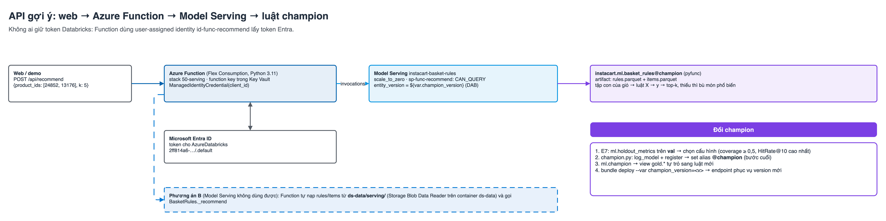

# 05 · MLflow, model champion, API và Power BI (cổng G5)

**Đầu vào:**
- E7 đã có `ml.association_rules` và `ml.holdout_metrics` ([04 §7](04_thuc_nghiem_danh_gia.md)).
- E1–E6 đã có trong `ml.experiment_runs`.

**Đầu ra:**
- Model `instacart.ml.basket_rules` trong Unity Catalog, có alias `@champion`.
- API gợi ý: Model Serving endpoint `instacart-basket-rules`, tùy chọn có Azure Function làm proxy. Nếu serving không dùng được thì Function tự phục vụ (phương án B).
- View `gold.association_rules`, `gold.recommendations`, `gold.experiment_metrics`, `gold.holdout_metrics`.
- Power BI trang 6–7.

**Xong khi:** checklist mục 6 đạt.

---

## 1. MLflow: theo dõi mọi lần chạy

| Thành phần | Giá trị | Ai tạo |
|---|---|---|
| Experiment | `/Shared/instacart-ds` | DAB `resources.experiments` ([devops/05 §4](../devops/05_databricks_platform.md)) |
| Artifact | Container `mlflow` qua external location `el-mlflow` | Terraform `30-databricks` (đã có) |
| Registry | Unity Catalog: `mlflow.set_registry_uri("databricks-uc")` | — |
| Model | `instacart.ml.basket_rules` | `champion.py` (job `ds-champion`) |

**Mỗi lần chạy trên Databricks** (`run_experiment.py`) ghi vào MLflow:
- **params**: mọi tham số của tổ hợp (`algo`, `grain`, `scale_pct`, `top_n`, `min_support`, `min_confidence`, `max_k`, `cores`, `rep`, `data_version`).
- **metrics**: `wall_s`, `rules_s`, `peak_mem_mb`, `n_itemsets`, `n_rules_single`, `n_rules_all`. Riêng E7 có thêm `hit_rate_at_10`, `precision_at_10`, `recall_at_10`, `order_coverage`.
- **tags**: `experiment` (E1–E7), `platform`, `status`, `run_key`.

`ml.experiment_runs` mới là **nguồn sự thật** cho báo cáo; MLflow dùng để xem và so nhanh. Biểu đồ *Parallel coordinates* của MLflow UI (params → metric) là một hình minh họa tốt cho rubric "trực quan kết quả trên các tham số".

## 2. Chọn champion và đóng gói model

### 2.1 Quy tắc chọn (ghi vào báo cáo trước khi xem kết quả)

1. Chỉ xét cấu hình E7 có `order_coverage ≥ 0,5` trên `val`: ít nhất một nửa số đơn nhận được gợi ý từ luật.
2. Trong số đó, chọn cấu hình có **HitRate@10 cao nhất trên `val`**. Bằng nhau thì chọn cấu hình **ít luật hơn**, vì model nhỏ hơn và dễ giải thích hơn.
3. Champion phải **hơn baseline phổ biến** trên `val`. Nếu không hơn, vẫn đăng ký model, nhưng báo cáo phải ghi rõ kết luận âm tính.
4. Báo cáo HitRate / Precision / Recall @10 của champion và baseline trên **`test`**.

Kết quả chọn ghi vào bảng `ml.champion (alias, run_key, min_confidence, model_version, chosen_at)`. View `gold.*` đọc bảng này để biết đang phục vụ luật nào.

### 2.2 Model `pyfunc`: giỏ hàng → món gợi ý

Model Serving không chạy được model Spark (`FPGrowthModel`), vì endpoint phục vụ không có Spark. Vì vậy luật của champion được xuất ra file Parquet và bọc trong một model **`pyfunc` thuần Python**: tra luật theo vế trái, giống hệt logic SQL ở [04 §7.2](04_thuc_nghiem_danh_gia.md). Bản đầu của hình kiến trúc ghi "FPGrowthModel tốt nhất"; trên thực tế thứ được đăng ký là **luật của FP-Growth** đóng gói thành `pyfunc`.

```python
# src/ml/serving/basket_rules.py
from itertools import combinations

import mlflow
import pandas as pd


class BasketRules(mlflow.pyfunc.PythonModel):
    """Input: cột product_ids (list[int]). Output: top-k món gợi ý theo luật, thiếu thì bù bằng món phổ biến."""

    def load_context(self, context):
        rules = pd.read_parquet(context.artifacts["rules"])    # antecedent(list[int]), item, confidence, lift
        items = pd.read_parquet(context.artifacts["items"])    # idx, product_id, product_name
        self.by_antecedent: dict[tuple[int, ...], list[tuple[int, float, float]]] = {}
        for a, i, c, lift in rules[["antecedent", "item", "confidence", "lift"]].itertuples(index=False):
            self.by_antecedent.setdefault(tuple(sorted(a)), []).append((int(i), float(c), float(lift)))
        self.pid2idx = dict(zip(items.product_id, items.idx))
        self.idx2pid = dict(zip(items.idx, items.product_id))
        self.idx2name = dict(zip(items.idx, items.product_name))
        self.popular = items.sort_values("idx").idx.head(50).tolist()     # idx nhỏ = phổ biến nhất
        self.max_left = max((len(a) for a in self.by_antecedent), default=1)

    def _recommend(self, product_ids: list[int], k: int) -> list[dict]:
        ctx = sorted({self.pid2idx[p] for p in product_ids if p in self.pid2idx})
        best: dict[int, tuple[float, float]] = {}
        for r in range(1, min(self.max_left, len(ctx)) + 1):
            for a in combinations(ctx, r):
                for item, conf, lift in self.by_antecedent.get(a, ()):
                    if item not in ctx and (conf, lift) > best.get(item, (-1.0, -1.0)):
                        best[item] = (conf, lift)
        ranked = sorted(best, key=lambda i: (best[i], -i), reverse=True)[:k]
        out = [{"product_id": int(self.idx2pid[i]), "product_name": self.idx2name[i], "confidence": best[i][0],
                "lift": best[i][1], "source": "rule"} for i in ranked]
        for i in self.popular:                                              # bù bằng món phổ biến
            if len(out) >= k:
                break
            if i not in ctx and i not in best:
                out.append({"product_id": int(self.idx2pid[i]), "product_name": self.idx2name[i],
                            "confidence": None, "lift": None, "source": "popular"})
        return out

    def predict(self, context, model_input: pd.DataFrame, params: dict | None = None) -> pd.DataFrame:
        """Một dòng / món gợi ý; input_row cho biết món đó thuộc giỏ thứ mấy trong request."""
        k = int((params or {}).get("k", 10))
        rows = [{"input_row": n, "rank": r + 1, **rec}
                for n, ids in enumerate(model_input["product_ids"])
                for r, rec in enumerate(self._recommend(list(ids), k))]
        cols = ["input_row", "rank", "product_id", "product_name", "confidence", "lift", "source"]
        return pd.DataFrame(rows, columns=cols).astype({"confidence": "float64", "lift": "float64"})
```

```python
# src/ml/champion.py  (phần đăng ký; việc chọn cấu hình theo §2.1 nằm ở đầu file)
import os

import mlflow
import pandas as pd
from mlflow import MlflowClient
from mlflow.models import infer_signature

from ml.serving.basket_rules import BasketRules

MODEL = "instacart.ml.basket_rules"
ML_PKG = os.path.dirname(os.path.abspath(__file__))                       # src/ml → đóng gói kèm model


def register(rules_path: str, items_path: str, run_key: str, min_conf: float) -> int:
    mlflow.set_registry_uri("databricks-uc")
    mlflow.set_experiment("/Shared/instacart-ds")
    example = pd.DataFrame({"product_ids": [[24852, 13176]]})               # chuối + túi chuối hữu cơ
    model = BasketRules()
    with mlflow.start_run(run_name=f"champion-{run_key[:8]}") as run:
        mlflow.log_params({"source_run_key": run_key, "min_confidence": min_conf})
        ctx = type("Ctx", (), {"artifacts": {"rules": rules_path, "items": items_path}})()
        model.load_context(ctx)
        signature = infer_signature(example, model.predict(None, example), params={"k": 10})
        info = mlflow.pyfunc.log_model(
            artifact_path="model", python_model=BasketRules(), signature=signature, input_example=example,
            artifacts={"rules": rules_path, "items": items_path}, pip_requirements=["pandas", "pyarrow"],
            code_paths=[ML_PKG],                                       # endpoint import được ml.serving.*
            registered_model_name=MODEL)
    version = int(info.registered_model_version)
    MlflowClient().set_registered_model_alias(MODEL, "champion", version)
    return version
```

- `rules_path` và `items_path` là file Parquet nhỏ, xuất từ `ml.association_rules` (lọc theo `run_key` của champion, `size(consequent) = 1`, `confidence ≥ min_conf`) và từ `ds_data.item_index` (cấp product). Hai file đi kèm model như artifact.
- Đã chạy thử với MLflow 2.17 (local): `log_model` → `load_model` → `predict` cho đúng thứ tự gợi ý; signature suy ra gồm input `product_ids: Array(long)`, output 7 cột, tham số `k` mặc định 10.
- Job `ds-champion` = `evaluate_holdout` (E7) → `champion` → `publish_gold`. Chạy tay, không đặt lịch.

## 3. API gợi ý



<sub>File gốc: [diagrams/ds_diagrams.drawio](diagrams/ds_diagrams.drawio), trang 4.</sub>

### 3.1 Phương án A (mặc định): Databricks Model Serving

Endpoint khai báo trong DAB. Phiên bản model truyền vào bằng biến lúc deploy, nên đổi champion chỉ cần deploy lại:

```yaml
# bundles/resources/serving_ds.yml
variables:
  champion_version: { default: "1" }
resources:
  model_serving_endpoints:
    basket_rules:
      name: instacart-basket-rules
      config:
        served_entities:
          - entity_name: instacart.ml.basket_rules
            entity_version: ${var.champion_version}
            workload_size: Small
            scale_to_zero_enabled: true                 # không có request thì không tốn tiền
      permissions:
        - { group_name: ds, level: CAN_MANAGE }
        - { service_principal_name: "${var.func_sp_application_id}", level: CAN_QUERY }
```

```bash
curl -s -X POST "https://$DATABRICKS_HOST/serving-endpoints/instacart-basket-rules/invocations" \
  -H "Authorization: Bearer $(az account get-access-token --resource 2ff814a6-3304-4ab8-85cb-cd0e6f879c1d --query accessToken -o tsv)" \
  -H "Content-Type: application/json" \
  -d '{"dataframe_records": [{"product_ids": [24852, 13176]}], "params": {"k": 5}}'
```

- **Spike bắt buộc** ([devops/01 §3.4](../devops/01_chuan_bi_va_spike.md)): Model Serving là dịch vụ serverless. Cần kiểm tra subscription Azure for Students và region đã chốt có cho tạo endpoint hay không.
- Endpoint tắt về 0 khi rảnh, nên request đầu tiên sau khi rảnh mất vài chục giây (cold start). Trước buổi demo, gọi thử một lần để đánh thức endpoint.

### 3.2 Azure Function (FaaS) làm proxy cho web

**Vì sao cần:**
- Trang web hoặc demo không nên giữ token Databricks.
- Function dùng **managed identity** lấy token Entra cho Databricks, rồi gọi endpoint.
- Function là thành phần FaaS duy nhất trong kiến trúc (rubric 1.4).

```python
# src/serving_func/function_app.py  (Azure Functions, Python v2 programming model)
import json
import os

import azure.functions as func
import requests
from azure.identity import ManagedIdentityCredential

app = func.FunctionApp(http_auth_level=func.AuthLevel.FUNCTION)
DATABRICKS_SCOPE = "2ff814a6-3304-4ab8-85cb-cd0e6f879c1d/.default"     # ID ứng dụng AzureDatabricks (cố định)
cred = ManagedIdentityCredential(client_id=os.environ["AZURE_CLIENT_ID"])     # user-assigned id-func-recommend


@app.route(route="recommend", methods=["POST"])
def recommend(req: func.HttpRequest) -> func.HttpResponse:
    body = req.get_json()
    ids = [int(x) for x in body.get("product_ids", [])][:50]
    if not ids:
        return func.HttpResponse("product_ids rỗng", status_code=400)
    token = cred.get_token(DATABRICKS_SCOPE).token
    r = requests.post(
        f"https://{os.environ['DATABRICKS_HOST']}/serving-endpoints/{os.environ['ENDPOINT_NAME']}/invocations",
        headers={"Authorization": f"Bearer {token}"},
        json={"dataframe_records": [{"product_ids": ids}], "params": {"k": int(body.get("k", 10))}},
        timeout=60)
    r.raise_for_status()
    recs = [p for p in r.json()["predictions"] if p["input_row"] == 0]      # một giỏ mỗi request
    return func.HttpResponse(json.dumps(recs, ensure_ascii=False), mimetype="application/json")
```

- Hạ tầng của Function nằm ở stack Terraform tùy chọn **`50-serving`** ([devops/03 §5.1](../devops/03_terraform_azure.md)): Function App gói Flex Consumption, Python 3.11, dùng user-assigned identity `id-func-recommend`. Identity này được **thêm vào workspace** dưới dạng service principal ([devops/05 bước 2](../devops/05_databricks_platform.md)) và được cấp `CAN_QUERY` trên endpoint.
- Function key là bí mật. Lưu vào Key Vault, **không** đặt trong code hay README.

### 3.3 Phương án B (khi Model Serving không dùng được)

Function **tự chạy model**:
- Lúc khởi động, đọc 2 file Parquet của champion (`rules`, `items`) từ container `ds/serving/` bằng managed identity (role *Storage Blob Data Reader* chỉ trên container `ds`).
- Gọi thẳng `BasketRules._recommend`.

Cách này vẫn có API thật và vẫn là FaaS, chỉ mất phần "model serving trong Databricks". Ghi rõ lựa chọn vào báo cáo.

## 4. View `gold.*` cho Power BI

```sql
-- src/ml/sql/publish_gold.sql  (task publish_gold, chạy bằng SP CI có ALL PRIVILEGES trên gold)
CREATE OR REPLACE VIEW instacart.gold.association_rules
COMMENT 'Luật kết hợp của champion (cấp product), có tên sản phẩm. Nguồn: ml.association_rules'
AS
WITH champ AS (SELECT run_key, min_confidence FROM instacart.ml.champion WHERE alias = 'champion'),
     names AS (SELECT idx, item_key AS product_id, item_name FROM instacart.ds_data.item_index
               WHERE data_version = 'v1' AND grain = 'product'),
     r AS (SELECT a.* FROM instacart.ml.association_rules a JOIN champ c
             ON a.run_key = c.run_key AND a.confidence >= c.min_confidence)
SELECT concat_ws(' + ', transform(r.antecedent, x -> element_at(m.names, x))) AS antecedent_names,
       concat_ws(' + ', transform(r.consequent, x -> element_at(m.names, x))) AS consequent_names,
       size(r.antecedent) AS antecedent_size, r.support, r.confidence, r.lift,
       element_at(m.ids, r.consequent[0]) AS consequent_product_id
FROM r CROSS JOIN (SELECT map_from_entries(collect_list(struct(idx, item_name))) AS names,
                          map_from_entries(collect_list(struct(idx, product_id))) AS ids FROM names) m;

CREATE OR REPLACE VIEW instacart.gold.recommendations
COMMENT 'Top 10 món mua kèm theo luật 1 → 1 của champion; dùng cho trang 2 (chi tiết sản phẩm)'
AS
WITH champ AS (SELECT run_key, min_confidence FROM instacart.ml.champion WHERE alias = 'champion'),
     ids AS (SELECT idx, CAST(item_key AS INT) AS product_id FROM instacart.ds_data.item_index
             WHERE data_version = 'v1' AND grain = 'product'),
     r AS (SELECT a.antecedent[0] AS a_idx, a.consequent[0] AS c_idx, a.confidence, a.lift
           FROM instacart.ml.association_rules a JOIN champ c ON a.run_key = c.run_key
           WHERE size(a.antecedent) = 1 AND size(a.consequent) = 1 AND a.confidence >= c.min_confidence)
SELECT ia.product_id, ic.product_id AS recommended_product_id, r.confidence, r.lift,
       row_number() OVER (PARTITION BY ia.product_id ORDER BY r.confidence DESC, r.lift DESC) AS rank
FROM r JOIN ids ia ON ia.idx = r.a_idx JOIN ids ic ON ic.idx = r.c_idx
QUALIFY rank <= 10;

CREATE OR REPLACE VIEW instacart.gold.experiment_metrics
COMMENT 'Trung vị 3 lần đo theo tổ hợp, kèm speedup và efficiency (Databricks + local)'
AS
WITH m AS (SELECT experiment, platform, algo, grain, scale_pct, top_n, min_support, cores,
                  percentile(wall_s, 0.5) AS wall_s, percentile(peak_mem_mb, 0.5) AS peak_mem_mb,
                  percentile(spill_mb, 0.5) AS spill_mb, max(n_itemsets) AS n_itemsets,
                  max(n_rules_single) AS n_rules_single, max(n_rules_all) AS n_rules_all,
                  count_if(status = 'ok') AS n_ok, count_if(status = 'timeout') AS n_timeout
           FROM instacart.ml.experiment_runs
           GROUP BY ALL)
SELECT m.*, t1.wall_s / m.wall_s AS speedup, t1.wall_s / m.wall_s / m.cores AS efficiency
FROM m LEFT JOIN m t1
  ON t1.cores = 1 AND t1.experiment = m.experiment AND t1.platform = m.platform AND t1.algo = m.algo
 AND t1.grain = m.grain AND t1.scale_pct = m.scale_pct AND t1.min_support = m.min_support
 AND t1.top_n <=> m.top_n;

CREATE OR REPLACE VIEW instacart.gold.holdout_metrics AS
SELECT * FROM instacart.ml.holdout_metrics;
```

- **View chạy bằng quyền của chủ view** (SP CI), nên vai `bi` chỉ cần `SELECT` trên `gold`, không cần quyền vào `ml` hay `ds_data` ([devops/05 bước 5](../devops/05_databricks_platform.md)).
- `CREATE OR REPLACE VIEW` là idempotent. Đổi champion chỉ cần cập nhật `ml.champion`; view tự trỏ sang luật mới.
- Trên trang 2, `gold.recommendations` **đứng cạnh** `gold.product_pair_counts` (baseline của DE). Số của DS tính trên đúng split `prior`, còn số của DE là xấp xỉ ([de/05 §2.2](../de/05_gold_serving.md)).

## 5. Power BI: trang 6 và 7

Chi tiết model và DAX nằm ở [de/07 §4](../de/07_power_bi.md) (P3 dựng semantic model, P4 làm trang 6–7). Tóm tắt:

| Trang | Visual chính | Tương tác |
|---|---|---|
| **6 · Luật kết hợp** | Bảng luật (vế trái → vế phải, support, confidence, lift); scatter support × confidence, cỡ điểm theo lift; thẻ số luật | Slicer `min confidence`, `min lift`, `antecedent_size`; chuột phải trên một luật → drill-through sang trang 2 theo `consequent_product_id` |
| **7 · Thực nghiệm thuật toán** | Đường thời gian theo MinSupp (E2), theo quy mô (E3), theo số item (E4, trục log); speedup và efficiency theo core (E5, E6); cột MapReduce và Spark (thời gian, byte ghi đĩa trung gian); HitRate@10 theo (MinSupp, MinConf) kèm đường baseline (E7) | Slicer `experiment`, `grain`, `platform`, `algo`; bookmark "Hiệu năng" / "Chất lượng luật" |

## 6. Checklist G5

- [ ] E1: `check_passed = true` cho cả 3 cấp. Đã ghi kết luận về tính exhaustive của MLlib FP-Growth.
- [ ] E2–E5: mọi tổ hợp có `status ∈ {ok, timeout}`, đủ 3 lần đo (`n_ok + n_timeout = 3` trong `gold.experiment_metrics`).
- [ ] E6: có kết quả của 3 cài đặt × đủ lưới, từ **một** máy; `n_result` bằng nhau giữa MapReduce và hai bản Spark ở cùng tổ hợp ([03 §5](03_hadoop_mapreduce_local.md)).
- [ ] E7: `ml.holdout_metrics` có 9 cấu hình × `val`, baseline × `val`/`test`, champion × `test`.
- [ ] `instacart.ml.basket_rules@champion` tồn tại; `ml.champion` trỏ đúng `run_key`.
- [ ] API trả lời `curl` ở §3.1 (hoặc Function ở §3.2/§3.3) trong < 2 giây khi đã nóng; có ảnh chụp.
- [ ] Tài khoản vai `bi` đọc được `gold.association_rules`; đọc `ml.experiment_runs` thì bị `PERMISSION_DENIED`.
- [ ] Power BI trang 6–7 đã publish, có trong app và mobile layout.
- [ ] Báo cáo có đủ biểu đồ ở [04 §8](04_thuc_nghiem_danh_gia.md), bảng đối chiếu với bài báo ([00 §2](00_tong_quan_ds.md)), ghi rõ giới hạn phần cứng và cách đo bộ nhớ.

## 7. Lỗi giữa chừng thì chạy lại thế nào

| Tình huống | Cách chạy lại | Vì sao an toàn |
|---|---|---|
| `champion` lỗi sau khi đã đăng ký version mới nhưng chưa gán alias | Chạy lại `ds-champion` | Version thừa không có alias nên không ai dùng; alias chỉ gán ở bước cuối |
| Đăng ký nhầm champion | `set_registered_model_alias` về version cũ, sửa `ml.champion`, deploy lại endpoint với `champion_version` cũ | Version cũ không bị xóa; view `gold.*` đọc theo `ml.champion` |
| Deploy endpoint lỗi | `databricks bundle deploy` lại | DAB đưa endpoint về đúng cấu hình khai báo |
| `publish_gold` lỗi | Repair run | `CREATE OR REPLACE VIEW`, không có trạng thái dở |
| Power BI lỗi khi refresh trang 6–7 | Refresh lại sau khi `publish_gold` xanh | View luôn đọc dữ liệu nhất quán của một champion |
