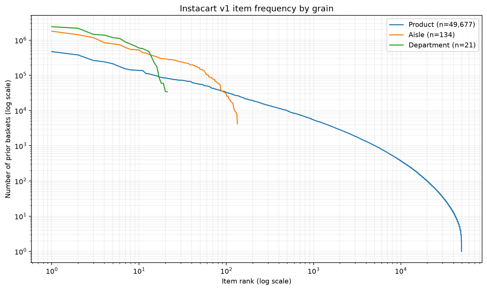

# AD-DS-11 · EDA dữ liệu v1

Chạy truy vấn chỉ đọc trên snapshot `v1` bằng notebook serverless ngày 2026-11-27. Dữ liệu dev từ AD-DE-21 (#57); schema được truyền qua widget `source_schema`.

Notebook run: `215684073076546` (hoàn tất thành công trên serverless).

## Kích thước và độ dài giao dịch

| Grain | n_tx prior | avg_len | p50 | p95 | max_len |
|---|---:|---:|---:|---:|---:|
| aisle | 3,214,874 | 7.26 | 6 | 16 | 57 |
| department | 3,214,874 | 4.74 | 4 | 9 | 18 |
| product | 3,214,874 | 10.09 | 8 | 25 | 145 |

## n(L1), n(C2) theo grain và MinSupport

Ước lượng broadcast dùng 128 byte cho mỗi ứng viên C2; đây là ước lượng tải bộ nhớ, không phải phép đo RSS.

| Grain | MinSupport | n(L1) | n(C2) | Ước lượng broadcast (MiB) |
|---|---:|---:|---:|---:|
| aisle | 0.0005 | 134 | 8,911 | 1.1 |
| aisle | 0.0010 | 134 | 8,911 | 1.1 |
| aisle | 0.0020 | 132 | 8,646 | 1.1 |
| aisle | 0.0050 | 119 | 7,021 | 0.9 |
| aisle | 0.0100 | 96 | 4,560 | 0.6 |
| aisle | 0.0200 | 77 | 2,926 | 0.4 |
| aisle | 0.0500 | 49 | 1,176 | 0.1 |
| aisle | 0.1000 | 16 | 120 | 0.0 |
| aisle | 0.2000 | 6 | 15 | 0.0 |
| department | 0.0005 | 21 | 210 | 0.0 |
| department | 0.0010 | 21 | 210 | 0.0 |
| department | 0.0020 | 21 | 210 | 0.0 |
| department | 0.0050 | 21 | 210 | 0.0 |
| department | 0.0100 | 21 | 210 | 0.0 |
| department | 0.0200 | 17 | 136 | 0.0 |
| department | 0.0500 | 16 | 120 | 0.0 |
| department | 0.1000 | 13 | 78 | 0.0 |
| department | 0.2000 | 9 | 36 | 0.0 |
| product | 0.0005 | 3,402 | 5,785,101 | 706.2 |
| product | 0.0010 | 1,772 | 1,569,106 | 191.5 |
| product | 0.0020 | 837 | 349,866 | 42.7 |
| product | 0.0050 | 252 | 31,626 | 3.9 |
| product | 0.0100 | 102 | 5,151 | 0.6 |
| product | 0.0200 | 39 | 741 | 0.1 |
| product | 0.0500 | 6 | 15 | 0.0 |
| product | 0.1000 | 2 | 1 | 0.0 |
| product | 0.2000 | 0 | 0 | 0.0 |

## Ngưỡng product được chọn

Chọn MinSupport **0.001**: đây là ngưỡng nhỏ nhất trong lưới có n(L1) ≤ 2.000. Kết quả n(L1) = 1,772, n(C2) = 1,569,106, ước lượng broadcast = 191.5 MiB. Ngưỡng 0.0005 vượt mục tiêu với n(L1) = 3,402.

## Holdout

| Eval part | n_eval | avg_context | avg_targets |
|---|---:|---:|---:|
| test | 62,132 | 5.79 | 5.30 |
| val | 62,232 | 5.78 | 5.29 |

## Phân phối tần suất item

